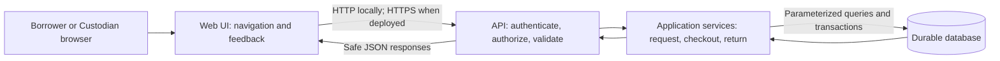
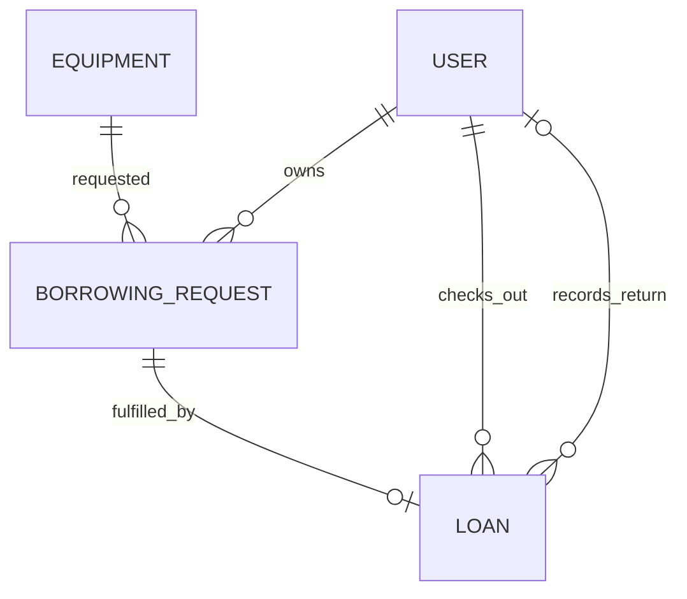

# System-Level Design Specification (SDS)

> **Project:** PEW-DIY — D.I.Y. Room Equipment Borrowing System
>
> **Deliverable:** D1-03 Part C — System-Level SDS | **Issue:** [#3](https://github.com/Peepipat-Suesoongnuen/PEW-DIY/issues/3)
>
> **Revision:** 7, 2026-11-23 | **Status:** Updated baseline for Sprint 1 + Sprint 2/3 contract architecture
>
> **Baseline:** [SRS](srs.md) rev 6 and [Feature Inventory](features.md) rev 2 (reconciled for Sprint 2; original D1 snapshot at `9d3c57b`)
>
> **Language:** English (SRS A-07). This is a system-level design specification: sections below document the **Implemented & Verified Sprint 1 + Lab 5 baseline (`d079bc6`)** alongside **Contracted / Planned Sprint 2 & Sprint 3 extensions (pending Issues [#99](https://github.com/Peepipat-Suesoongnuen/PEW-DIY/issues/99) and [#100](https://github.com/Peepipat-Suesoongnuen/PEW-DIY/issues/100))**, while preserving early Deliverable 1 option analyses as **Historical / Superseded** context.

## 1. Sources, Status, and Design Boundaries

The requirements baseline remains in the [SRS](srs.md), feature ownership in the [Feature Inventory](features.md), and requirement-to-sprint mapping in the [Traceability Matrix](traceability.md). This SDS defines their system-wide design implications; it does not replace their requirement text or introduce new product capabilities. Detailed feature endpoints, payload fields, AC, test IDs, and STS belong to [D1-05]. Application implementation belongs to [D1-06].

| Source checked | Relevant sections | Use in this SDS |
|---|---|---|
| `project_deliverable_1_v1.pdf` | §3.3, PDF p.3 | Part C content: architecture/data/UI/API/access/configuration design |
| `group_work_specs_v1.pdf` | §5.1–§5.3, PDF pp.3–4; §8.1, PDF p.10 | Logical layers, durable storage, identity/access, design now and Docker/GCP implementation in Lab 5 |
| [Issue #1](https://github.com/Peepipat-Suesoongnuen/PEW-DIY/issues/1), [Issue #2](https://github.com/Peepipat-Suesoongnuen/PEW-DIY/issues/2) | Issue bodies and comments checked 2026-11-04; both closed, no comments | Upstream scope; resulting local SRS and Part B documents supply stable IDs |
| [Issue #3](https://github.com/Peepipat-Suesoongnuen/PEW-DIY/issues/3) | Scope, tasks, AC-C-01–AC-C-06 | Initial Part C scope (`AC-C-01`–`AC-C-06`); open stack/session choices listed in Issue #3 were subsequently resolved in rev 3 |
| [Repository instructions](../AGENT.md) | §2–§3, §11–§16 | Verify actual stack, preserve requirements, distinguish proposals and open questions |

The PDF files were read from the team's local `D:/Software_Engineering/PEW-DIY/lab-document/` directory; they are not tracked repository files. For the final D1 hand-in, include the complete Part C content in the combined PDF as required by `project_deliverable_1_v1.pdf` §4.1; a repository link alone is insufficient.

**Status vocabulary:** **Confirmed** means supported by the SRS or course documents; **Resolved / Implemented** means team-approved decisions backed by merged Sprint 1 / Lab 5 implementation (`PR #22`, `PR #33`, `PR #57`/`#79`); **Proposed / Contracted** means Sprint 2/3 contract or design additions whose implementation is pending Issues [#99](https://github.com/Peepipat-Suesoongnuen/PEW-DIY/issues/99)/[#100](https://github.com/Peepipat-Suesoongnuen/PEW-DIY/issues/100); **Open** means a decision is still required.

**Reconciliation:** Historical Issue #1/#3 and revision-1 draft notes described stack, session, and SRS OQ decisions as open; subsequent revisions (§2.1, §7.2, §10, SRS rev 6) resolved `SDS-OQ-01..04` and `SRS OQ-02..06`, while retaining explicit synthetic catalog labeling under `OQ-01` until room staff populate real catalog items via `F-08` (`FR-09`).

## 2. Technology Stack and Architecture

### 2.1 Selected and Implemented Stack (`SDS-OQ-01/02` Resolved)

The team selected and implemented the Sprint 1 stack below (`SDS-OQ-01/02` resolved at rev 3 via `PR #22`; frontend stack added at `UI-02` via `PR #33`). Component details and runnable manifests live in `package.json`, `client/package.json`, `server/src/`, `client/src/`, and `e2e/`.

| Layer | Selected & Implemented Technology | Verification / Evidence |
|---|---|---|
| **Web UI** | React 19 + Vite + TypeScript + Tailwind CSS v4 (`@theme` tokens) + Lucide Icons, served via Express SPA fallback (`client/dist`) | PR #33 (`ARCH-01`, `docs/sprints/sprint-1/ui-02-evidence.md`); legacy `.html` coexistence until Sprint 2 Phase P4 (#100) |
| **Runtime / API** | Node.js 24 + TypeScript + Express 5 | PR #22 implementation; `package.json` / `package-lock.json` |
| **Database** | PostgreSQL 17 (`pg` driver; parameterized SQL + ordered SQL migrations `001`–`003`) | PR #22 `server/src/db` (Sprint 2 migration `004` contracted pending #99) |
| **Password Hashing** | Argon2id via `@node-rs/argon2` | PR #22 `server/src/services/password.ts` |
| **Identity Transport** | DB-backed opaque server session (`sessions`, SHA-256 key) + `HttpOnly` cookie (`SameSite=Lax`) + trusted-origin anti-CSRF (`APP_ORIGIN`), idle `60` min / absolute `480` min | PR #22 `server/src/services/session.ts`, `auth-routes.ts`; `TEST-F01-07/08/15/16` |
| **Test Tooling** | Vitest + Supertest (server), Vitest + Testing Library (client), Playwright Chromium (3 viewports E2E) | `server/tests/`, `client/src/test/`, `e2e/` |

#### Historical Revision-1 Snapshot (Superseded by Rev 3 & PR #33)

> **Historical note:** At revision 1 (`9d3c57b`), before application source existed, the repository held documentation only and no stack could yet be recorded (`AC-C-01` gap). That gap is closed by the resolved selections above; the criteria preserved here (team familiarity, protected API testability, atomic DB transactions, reproducible migrations/seed, Docker/GCP suitability) guided that selection.

### 2.2 Logical Architecture — Modular Monolith

The course permits a modular monolith: UI, API/application, and database are logical responsibilities, not a requirement for three servers or containers. One application can serve the UI and API; the database remains a durable store.

**Physical layout (reconciled rev 3–7):** the repository separates frontend and backend directories — `client/` (React 19 + Vite + TypeScript + Tailwind CSS v4 SPA, selected/implemented in PR #33; legacy `.html` coexistence until Sprint 2 Phase P4) and `server/` (`server/src` application code: config/db/routes/services; `server/tests` tests, kept outside the build output). This is a directory-level separation of the same logical layers below; **the deployment topology is unchanged** — one application container serves UI and API (§8.2, Lab 5 R-01).



| Component | Responsibility and trust boundary | Requirement / feature basis |
|---|---|---|
| UI | Display API state and helpful input checks; provide no authoritative stock, role, borrower ID, due date, or loan status | FR-03, FR-06/07, F-01–F-09 |
| API boundary | Resolve authenticated principal, allow-listed inputs, role and record ownership; return safe errors | FR-01–FR-05, NFR-01/02, F-01 |
| Application services | Enforce borrowing/checkout/return rules using current DB state; obtain time from a controlled server clock | BR-01–BR-09, F-03–F-07 |
| Data access | Parameterized access, atomic operations, FK/check/uniqueness constraints and ownership-scoped queries | BR-03/11, NFR-04/05/06 |
| Database | Persist committed state independently of browser and application process; reject structural integrity violations | FR-08/11/14/15, BR-11, NFR-04 |

Keep identity/access, catalog/availability, borrowing/loans, and later reporting as modules within the application. Do not add microservices, external messaging, or real student/room data. Sprint 1 (`d079bc6`) uses Direct Checkout (`A-02`) with no approval step; Sprint 2 contracts add the non-reserving approval workflow (`A-11`, `BR-12`, `PENDING → APPROVED/REJECTED/CANCELLED → CHECKED_OUT`, pending Issues [#99](https://github.com/Peepipat-Suesoongnuen/PEW-DIY/issues/99)/[#100](https://github.com/Peepipat-Suesoongnuen/PEW-DIY/issues/100)) within the same modular monolith. Prefer one browser origin for UI and API; if separate origins are selected, explicitly allow only configured origins and document credential/CORS behavior in [D1-05].

## 3. Data Model and Consistency

### 3.1 Logical Entities (Sprint 1 Implemented; Sprint 2 Contracted)

With `SDS-OQ-01` resolved (§2.1), Sprint 1 SQL migrations (`001`–`003` in `server/src/db/migrations.ts`) implement `users`, `sessions`, `equipment`, `borrowing_requests`, and `loans` using PostgreSQL `TEXT` IDs, `INTEGER` quantities, and `TIMESTAMPTZ`/`DATE` columns. Sprint 2 additions (`image_url`, `catalog_status`, `request_bundles`, `approval_status`, `requested_days`, `return_requested_at`, `notifications`) are **contracted in `docs/sprints/sprint-2/` (pending Issue #99 migration `004`)**. No individual serial-number entity is introduced (SRS A-01).

| Entity | Principal fields (Sprint 1 Implemented vs Sprint 2 Contracted `#99`) | Integrity, ownership, and use |
|---|---|---|
| **User** (`users` + `sessions`) | **Implemented (`MIGRATION_001_SQL`):** `id` PK; `username` text; `password_hash` text; `role` constrained code (`BORROWER` / `CUSTODIAN`); `sessions` table (`session_key`, `user_id`, `created_at`, `expires_at`, `absolute_expires_at`, `revoked_at`, `last_seen_at`) | Unique username; exactly one role (`BORROWER` or `CUSTODIAN`); Argon2id `password_hash` never exposed in responses. Seeded accounts (`B-A`, `B-B`, `C-A`); no registration feature (FR-01–FR-05, BR-10). |
| **Equipment** (`equipment`) | **Implemented (`MIGRATION_001_SQL`):** `id` PK; `name`, `description`, `category` text; `quantity_total` integer (available quantity is derived from `loans` per §3.3, not stored)<br>**Contracted (`MIGRATION_004_SPRINT2_SQL`, `#99`):** `image_url` (`TEXT NOT NULL DEFAULT ''`), `catalog_status` (`ACTIVE`/`RETIRED`, default `ACTIVE`) | Required catalog fields; `quantity_total >= 0` (`BR-03` invariant `0 <= held <= quantity_total` enforced on derived reads and locked transactions). In Sprint 2 (`F-08`, `A-10`/`FR-09`, pending Issue #99), reducing `quantity_total < held` is rejected (`BR-06`, `409 HELD_QUANTITY_CONFLICT`), while retiring (`ACTIVE` → `RETIRED`) prevents new borrowing (`BR-01`, `409 EQUIPMENT_RETIRED`) without deleting active or historical loans. |
| **BorrowingRequest** (`borrowing_requests` + `request_bundles`) | **Implemented (`MIGRATION_002_REQUESTS_SQL`):** `id` PK; `borrower_id` FK User; `equipment_id` FK Equipment; `quantity_requested` integer; `created_at` timestamp (status `SUBMITTED`/`CHECKED_OUT` derived from linked `loans`)<br>**Contracted (`MIGRATION_004_SPRINT2_SQL`, `#99`):** `request_bundles` (`id`, `borrower_id`, `purpose_category`, `purpose_detail`, `requested_days`, `created_at`) + columns on `borrowing_requests` (`bundle_id`, `purpose_category`, `purpose_detail`, `requested_days` `1..14` default `7`, `approval_status` `PENDING`/`APPROVED`/`REJECTED`/`CANCELLED`, `reviewed_by`, `reviewed_at`, `decision_note`) | `quantity_requested >= 1` up to derived `quantity_available` at submission (`OQ-02` / `A-12` resolved: multi-unit up to current stock, no extra per-borrower cap). Owner is always the authenticated Borrower. Sprint 1 uses Direct Checkout (`A-02`, no approval state); Sprint 2 contracts add `A-11` non-reserving approval (`PENDING → APPROVED/REJECTED/CANCELLED → CHECKED_OUT`, `BR-12`, pending Issue #99). |
| **Loan** (`loans`) | **Implemented (`MIGRATION_003_LOANS_SQL`):** `id` PK; `request_id` unique FK BorrowingRequest; `quantity_borrowed` integer; `checked_out_by` FK User; `checkout_at` timestamp; `due_on` date; `returned_at` optional timestamp; `returned_by` optional FK User<br>**Contracted (`MIGRATION_004_SPRINT2_SQL`, `#99`):** `return_requested_at` optional timestamp, `return_requested_by` optional FK User, `return_note` (`TEXT NOT NULL DEFAULT ''`) | `quantity_borrowed >= 1`. Borrower/equipment are resolved through the linked request (`borrowing_requests`). Service enforces that checkout actor is Custodian (`BR-04`). Full-quantity return policy (`OQ-02` / `A-12`) is resolved (§3.4); Sprint 2 two-step return (`request-return` → Custodian `return`) is contracted in `f-06-return.md` (pending Issue #99). |
| **Notification** (`notifications`) | **Contracted (`MIGRATION_004_SPRINT2_SQL`, `#99`):** `id` PK; `user_id` FK User; `kind` (`REQUEST_APPROVED`/`REQUEST_REJECTED`/`LOAN_DUE_SOON`/`LOAN_OVERDUE`); `reference_id`, `title`, `message`, `created_at`, `read_at`, `cleared_at` | Contracted for Sprint 2 (`F-07` / `F-11`, `FR-19`, `BR-13`, pending Issue #99): `UNIQUE (user_id, kind, reference_id)` stores persistent dismissible/clearable alerts per user without mutating request or loan records. |

**Role representation:** the two role codes are a constrained field on User; no role-management API or multi-role account exists.

**Loan relationship and resolved quantity policy (`OQ-02` / `A-12`):** one `borrowing_requests` row concerns one equipment type and is fulfilled by at most one `loans` row (`UNIQUE (request_id)`) for the full `quantity_requested`. Per resolved policy `A-12` (`docs/srs.md` rev 6), multi-unit requests up to current `quantity_available` are allowed with no additional per-borrower cap, and split fulfillment / partial return is prohibited. In Sprint 2 (`F-11`, pending Issue #99), a multi-item `request_bundles` parent groups multiple `borrowing_requests` rows while preserving the 1-request-to-1-loan invariant per item.



All links back to User/Equipment preserve history: do not cascade-delete requests/loans when catalog records change. A loan's borrower/item are retrieved through its request. A Custodian's `checked_out_by`/`returned_by` is actor attribution, not borrower ownership. Database FK checks cannot establish user roles alone; the service must validate roles before writing.

### 3.2 Lifecycle and Direct Checkout

```mermaid
stateDiagram-v2
    [*] --> SubmittedRequest: Borrower submits; availability checked
    SubmittedRequest --> ActiveLoan: Custodian checkout; availability rechecked
    ActiveLoan --> ReturnedLoan: Custodian return, Sprint 2
```



The diagram shows domain progression; request and loan remain distinct persisted records. A submitted request expresses intent and — **Confirmed by team decision (Direction A, 2026-11-06; SRS BR-12/A-11)** — does not reserve units or reduce availability; only a committed Active Loan reduces Available Quantity. Concurrent requests can therefore outnumber stock; successful request creation does not promise successful checkout. Checkout rechecks availability and may reject a previously submitted request. No separate approve/reject/cancel/expiry step exists in Sprint 1; per the same team decision, an approval workflow is added in **Sprint 2 only** (specification deferred to the Sprint 2 contracts) and its pending requests still do not reserve units.

### 3.3 Availability Invariant and Checkout Transaction

**Confirmed & Implemented (`server/src/services/catalog.ts`, `borrowing-request.ts`, `loan.ts`):** Availability is **derived** at query/transaction time from `equipment.quantity_total` and active `loans` (`returned_at IS NULL`) rather than storing a separate mutable `quantity_available` column on `equipment`:

```text
held(item)      = sum(loans.quantity_borrowed WHERE returned_at IS NULL for item)
available(item) = equipment.quantity_total - held(item)
invariant       = 0 <= held(item) <= equipment.quantity_total
```

Under the selected full-quantity return policy (`A-12`, `BR-09`), an active loan contributes all `quantity_borrowed` until the Custodian confirms full return (`returned_at IS NOT NULL`), at which point held quantity drops to zero (partial return was rejected and is out of scope — see §3.4). Invalid aggregates (`held < 0` or `held > quantity_total`) raise `AvailabilityIntegrityError` / `AVAILABILITY_INTEGRITY_ERROR` rather than clamping with `max(0, available)`. For a single-unit item, positive integer quantities and this invariant allow at most one active loan.

**Implemented transaction protocol (`server/src/services/loan.ts` & `borrowing-request.ts`, `SDS-OQ-01` Resolved):**

1. Authenticate and authorize role (`CUSTODIAN` for checkout; `BORROWER` for request creation). Load the request's immutable `equipment_id`; never accept borrower, due date, or actor identity from the checkout payload.
2. Begin a PostgreSQL `READ COMMITTED` transaction and acquire row-level locks in consistent order: `SELECT id FROM equipment WHERE id = $1 FOR UPDATE`, then `SELECT * FROM borrowing_requests WHERE id = $1 FOR UPDATE`. Reject an already fulfilled request (`409 ALREADY_CHECKED_OUT`).
3. Re-read `quantity_total` and derived `quantity_available` (`quantity_total - held`) via `getEquipment(client, equipmentId)` **after** acquiring the lock so committed concurrent checkouts/returns are visible, and enforce `assertCheckoutAvailable` (`1..quantity_available`, `OQ-02` / `A-12`). Reject insufficient stock (`409 INSUFFICIENT_AVAILABILITY`) without creating a loan.
4. Insert exactly one `loans` row linked to that request (`UNIQUE (request_id)`), with server-assigned `checked_out_by`, `checkout_at` (UTC), and `due_on` (`Asia/Bangkok` calendar date + `7` days in S1, or `requested_days` `1..14` contracted in S2). Availability changes automatically through the committed loan row.
5. `COMMIT` all writes together, then respond. Any validation, conflict, or DB error runs `ROLLBACK` (`TEST-F05-04/05/08`; transient lock/serialization codes `40P01`/`40001`/`55P03` return `503 RETRY_LATER`).

Every writer affecting held units or total quantity (checkout, Sprint 2 return, and Sprint 2 total adjustment) uses the same Equipment-first `FOR UPDATE` serialization protocol so multi-instance Cloud Run deployments cannot race. At request creation (`borrowing-request.ts`), the service validates derived availability from the DB under the same `equipment FOR UPDATE` lock without decrementing stock (`BR-01`, `BR-12`). Sprint 2 catalog total reductions (`F-08`, pending `#99`) reject `new_total < held` (`409 HELD_QUANTITY_CONFLICT`) under the same lock.

### 3.4 Return, Dates, and Later-Sprint Extensions

**Resolved A-12 / SRS OQ-02 policy status (`docs/srs.md` rev 6; shared-team baseline peer ratification tracked in PR #98):** multiple units up to current available stock; no additional per-borrower cap; **full-quantity return only** per loan (user decisions 2026-11-06 and 2026-11-23). Request-time quantity bounds are enforced by F-04 (Sprint 1); Sprint 2 two-step return notice (`request-return`) → Custodian confirm (`return`) is contracted in `docs/sprints/sprint-2/f-06-return.md` (implementation pending Issues [#99](https://github.com/Peepipat-Suesoongnuen/PEW-DIY/issues/99)/[#100](https://github.com/Peepipat-Suesoongnuen/PEW-DIY/issues/100)). The table below preserves the **historical D1 design comparison**; full-quantity return is the selected policy and the partial-return option was **rejected**:

| Historical D1 return option | Status & data/consistency impact |
|---|---|
| **Full-quantity return only (Selected — `A-12` / `BR-09`)** | **Selected policy:** `returned_at`/`returned_by` are set atomically when all borrowed units of the loan return (after optional Borrower `return_requested_at` notice in Sprint 2 `F-06`). Loan remains active until Custodian confirmation. A repeat return changes nothing and is rejected with `409 ALREADY_RETURNED`. |
| Partial returns allowed *(Historical rejected alternative)* | **Rejected / Not Selected (`A-12`):** Would have required separate partial-return records and `quantity_borrowed - total_returned` remaining-held tracking. Excluded from the core schema and product scope. |

> **Historical note on rejected partial-return option:** Because full-quantity return was selected under `A-12` (`OQ-02` closed), no partial-return table or partial-quantity parameter is part of the schema or Sprint 2 `F-06` contract. Closing an active loan always restores its full `quantity` (`quantity_borrowed`) to `equipment.quantity_available` in a single atomic transaction (`BR-09`, `NFR-06`).

**Date representation — user-confirmed for Issue #12 (2026-11-07):** store event timestamps as UTC instants; calculate `due_on` as the checkout's calendar date in `Asia/Bangkok` plus seven calendar days in Sprint 1 (A-03/BR-07; extended to `1–14` requested calendar days, default `7`, in Sprint 2 `F-11`). The user explicitly answered “ยืนยันใช้ Asia/Bangkok” in the implementation session, resolving SDS-OQ-03 for implementation; this is not fabricated teammate approval. Configure `APP_TIMEZONE=Asia/Bangkok`; an absent zone disables checkout with safe 503, and an invalid zone fails startup. Overdue is contracted in Sprint 2 (`F-07`): its derivation is `returned_at IS NULL AND business_current_date > due_on` (BR-08), with equality not overdue. Clients cannot choose the due date. See [F-05 contract and execution evidence](sprints/sprint-1/f-05-checkout-active-loan.md) for local-midnight/month/year boundary tests.

Sprint 2 contracts add return (`F-06`), overdue & persistent in-app notifications (`F-07`), catalog management/search/filter/sort & full loan history (`F-08`), and request approval/bundles/1–14d duration/print slip (`F-11`) — all pending implementation in Issues [#99](https://github.com/Peepipat-Suesoongnuen/PEW-DIY/issues/99) and [#100](https://github.com/Peepipat-Suesoongnuen/PEW-DIY/issues/100); Sprint 3 reporting (`F-09`) reads the same persisted catalog/loan data. No separate reporting database, scheduled overdue mutation job, financial penalties, or external email/SMS notification service is used.

## 4. Database Setup, Migrations, and Synthetic Seed

With `SDS-OQ-01` resolved (§2.1), runnable Sprint 1 setup, ordered SQL migrations (`MIGRATION_001_SQL`, `MIGRATION_002_REQUESTS_SQL`, `MIGRATION_003_LOANS_SQL` in `server/src/db/migrations.ts`), idempotent synthetic seed (`server/src/db/seed.ts`), and verification commands are **implemented and active** on `d079bc6` (`README.md`, `package.json`, `NFR-08`). Sprint 2 schema migration `004` is **contracted pending Issue [#99](https://github.com/Peepipat-Suesoongnuen/PEW-DIY/issues/99)**. The implemented procedure and invariants are:

1. **Pinned runtime & isolated databases (Implemented):** Node.js 24 + PostgreSQL 17 (`package.json` scripts) use an isolated development database (`DATABASE_URL`) and disposable test databases/schemas (`TEST_DATABASE_URL` / `CI_TEST_DATABASE_URL`); neither uses real university data.
2. **Tracked `.env.example` & fail-closed config (Implemented):** `.env.example` provides non-secret variable names and placeholders only. `server/src/config/config.ts` validates required DB/auth/timezone settings before accepting requests and fails closed when incomplete.
3. **Ordered SQL migrations (Implemented `001`–`003`; Contracted `004` in `#99`):** `npm run migrate` (and `npm run migrate:test`) applies idempotent SQL migrations from `server/src/db/migrations.ts`: `MIGRATION_001_SQL` (`users`, `sessions`, `equipment`) → `MIGRATION_002_REQUESTS_SQL` (`borrowing_requests`) → `MIGRATION_003_LOANS_SQL` (`loans` with FKs, checks, and unique `request_id`). Sprint 2 adds `004` (`image_url`, `catalog_status`, `request_bundles`, `approval_status`, `requested_days`, `return_requested_at`, `notifications`) in Issue [#99](https://github.com/Peepipat-Suesoongnuen/PEW-DIY/issues/99).
4. **Idempotent synthetic seed (Implemented):** `npm run seed` (`server/src/db/seed.ts`) inserts deterministic synthetic fixtures (`docs/sprints/sprint-1/fixtures.md`) using `ON CONFLICT DO NOTHING` so existing loans, stock, passwords, and role assignments are preserved on re-runs. Destructive reset is never an application startup step.
5. **Restart & redeployment durability (Implemented & Verified):** Verified by `server/tests/restart-e2e.test.ts`, `npm run verify:sprint1`, and Lab 5/6 Cloud Run + Cloud SQL (`pewdiy-pg`) restart/redeploy checks (`C-05`, `UAT-08`).

| Implemented seed fixture (`server/src/db/seed.ts`) | Purpose & `OQ-01` synthetic-catalog status |
|---|---|
| `B-A` (`borrower_a`), `B-B` (`borrower_b`), `C-A` (`custodian_a`) | Two Borrower accounts and one Custodian account for own-vs-other record tests and role-denied API calls. Passwords are supplied via transient local/private seed environment variables (`SEED_BORROWER_A_PASSWORD`, etc.), hashed with Argon2id, and never written to Git, logs, or PDFs. |
| `E-ONE` (`1/1`), `E-MANY` (`3/3`), `E-ZERO` (`0/0`) | Deterministic synthetic catalog exercising single-unit exclusivity (`BR-03`), multi-unit pooling (`A-12`), and zero-stock rejection (`BR-01`/`BR-02`). Under `SRS OQ-01`, these fixtures remain explicitly labeled synthetic test/demo data; room staff can add/edit actual room items in Sprint 2 via `F-08` (`FR-09`). |
| Clean initial borrowing state | Zero pre-existing requests or loans after fresh seed; all requests and loans are created through the transactional service layer. |

Seed only salted Argon2id password hashes; generate hashes from transient local/CI input and protect logs from credential/hash output (`project_deliverable_1_v1.pdf` §4.4).

**Implemented constraints & indexes (`001`–`003`, plus `004` contracted in `#99`):** FK-backed owner/item lookups; unique `users.username` and `loans.request_id`; `quantity_total >= 0`, `quantity_requested > 0`, and `quantity_borrowed > 0` `CHECK` constraints; indexes on `borrowing_requests(borrower_id, created_at)`, `borrowing_requests(equipment_id)`, and `loans(request_id) WHERE returned_at IS NULL`. Cross-row stock limits (`0 <= held <= quantity_total`) are enforced by the derived-availability calculation and `SELECT ... FOR UPDATE` transaction protocol (§3.3) in addition to row `CHECK` constraints.

## 5. Main Screens and Shared UI Behavior

Sprint 1 routes (`/login`, `/catalog`, `/equipment/:id`, `/requests`, `/loans`, `/custodian/requests`) are **implemented in React 19 (`client/src/`)** on `d079bc6`. Sprint 2/3 screens and enhancements (`/requests/new`, loan return/overdue/history tabs, catalog CRUD modal, notification bell, `/reports`) are **contracted pending Issue [#100](https://github.com/Peepipat-Suesoongnuen/PEW-DIY/issues/100)**. Role-based visibility helps navigation; §6 controls API access regardless of the UI.

| Screen / navigation | Role and data shown | Feature / allocation & status |
|---|---|---|
| Login → catalog | Both roles; generic invalid-credentials feedback; fetch current-user identity after login/reload | F-01, Sprint 1 (**Implemented**) |
| Catalog → item detail → request form | Both roles read name/category/quantity/availability; only Borrower submits a request | F-02/F-03/F-04, Sprint 1 (**Implemented**); search/filter/sort & item images F-08 in Sprint 2 (**Contracted `#100`**) |
| My requests & Create request | Borrower, own requests; Sprint 2 adds multi-item bundle creation (`/requests/new`), purpose, 1–14d duration, and cancel | F-04, Sprint 1 (**Implemented**); Sprint 2 extensions F-11 (**Contracted `#100`**) |
| My active loans & loan slip | Borrower, own item/quantity/checkout/due data; Sprint 2 adds return notice (`request-return`), full history, and printable loan slip | F-05, Sprint 1 (**Implemented**); F-06/F-08/F-11 in Sprint 2 (**Contracted `#100`**) |
| Submitted requests → approve / reject / checkout | Custodian, submitted requests and checkout action; Sprint 2 adds `approve`/`reject` gate (`A-11`) before checkout | F-04/F-05, Sprint 1 (**Implemented**); F-11 in Sprint 2 (**Contracted `#100`**) |
| Loan management / return / overdue | Custodian, all loans (`ACTIVE`, `RETURN_PENDING`, `OVERDUE`, `RETURNED`) and confirm-return controls | F-06/F-07/F-08, Sprint 2 (**Contracted `#100`**) |
| Catalog management / notifications | Custodian catalog CRUD (`ACTIVE`/`RETIRED`, `image_url`); persistent in-app notification bell for both roles | F-07/F-08, Sprint 2 (**Contracted `#100`**) |
| Inventory reports (`/reports`) | Custodian, inventory/loan/overdue summary cards and tables | F-09, Sprint 3 (**Contracted `#100`**) |

Provide visible navigation appropriate to the current server-returned role and an accessible logout action. Do not expose a general Custodian all-loans list in Sprint 1 merely because the checkout response includes a created loan (FR-18 is Sprint 2).

| State | Shared UI/API behavior (Implemented in Sprint 1; carried across Sprint 2/3 contracts) |
|---|---|
| Validation | Show field errors next to inputs, preserve safe entered data, and repeat validation on the server. Multi-unit quantity bounds (`1..quantity_available`, `OQ-02` / `A-12`) are enforced; never calculate the authoritative due date/availability in the browser. |
| Loading / mutation | Indicate loading, prevent duplicate form submission while pending, and update from the committed API response. Do not show checkout success before commit. |
| Empty | Distinguish an empty catalog, no own requests/loans, and zero availability. Zero availability is a valid state; disable request affordance with an explanation. |
| Conflict | Explain that stock or request state changed; re-fetch current availability/request state. No automatic repeated checkout after an ambiguous response. |
| Unauthorized / forbidden | On 401 clear stale identity/private views and return to login; on 403 show denied access without the target record. Clear private cached data on logout/user change. |
| Unexpected error | Show a generic retry message and request ID if provided; no server stack, SQL, credentials, or private record content. |

## 6. API Conventions and Role/Record Access

### 6.1 API Conventions (Implemented in Sprint 1; Extended by Sprint 2/3 Contracts)

All endpoints use `/api/*`, JSON request/response bodies, and resource-oriented routes (`/api/auth/*`, `/api/equipment/*`, `/api/requests/*`, `/api/loans/*` implemented in Sprint 1; `/api/request-bundles/*`, `/api/notifications/*`, `/api/reports/summary` contracted for Issues [#99](https://github.com/Peepipat-Suesoongnuen/PEW-DIY/issues/99)/[#100](https://github.com/Peepipat-Suesoongnuen/PEW-DIY/issues/100)). Exact paths, payloads, and test IDs live in `docs/sprints/sprint-1/`, `docs/sprints/sprint-2/`, and `docs/sprints/sprint-3/`.

Success returns a documented `data` object/list (or an explicitly documented empty response). Errors use a consistent safe envelope, for example:

```json
{
  "error": {
    "code": "INSUFFICIENT_AVAILABILITY",
    "message": "Equipment is no longer available.",
    "requestId": "synthetic-request-id"
  }
}
```

| HTTP result | Implemented / Contracted convention |
|---|---|
| 200 / 201 / 204 | Successful read/action, newly created resource, or documented no-content action respectively |
| 400 | Malformed JSON, wrong types, missing fields, or rejected input fields; optional safe field-error list |
| 401 | Missing/invalid/expired/revoked authentication, or generic invalid login; no private response data |
| 403 | Authenticated wrong role or cross-borrower access, consistent with NFR-02; never include the other borrower's record |
| 404 | Resource absent within an authorized scope; perform ownership checks before returning private information |
| 409 | Availability or lifecycle conflict, including repeated checkout/return; no partial writes |
| 500 / 503 | Unexpected failure or temporary service/DB unavailability; generic safe response, redacted internal diagnostics |

Validate allow-listed fields and supported content types; do not bind incoming JSON directly to persistence models. User/role/owner, checkout actor, due date, derived availability and lifecycle fields are server-controlled. Parameterize DB queries. Authenticate before protected reads/writes, then authorize role and record scope, then validate/apply domain operations. No private record is returned in a rejection. Log request identifiers and safe outcome codes; omit passwords, hashes, tokens, cookies and private response bodies.

### 6.2 Role × Operation × Record-Scope Matrix

**Confirmed role/ownership basis:** FR-04/05, BR-04/05/06. **Implemented Sprint 1 (`S1`) & Contracted Sprint 2/3 (`S2`/`S3`) access matrix:** `Denied` means a backend denial (`401`/`403`) enforced by server middleware/services even when the caller constructs an API request manually. Sprint 1 (`S1`) operations are active on `d079bc6`; Sprint 2/3 (`S2`/`S3`) operations are contracted pending Issues [#99](https://github.com/Peepipat-Suesoongnuen/PEW-DIY/issues/99)/[#100](https://github.com/Peepipat-Suesoongnuen/PEW-DIY/issues/100).

| Operation | Unauthenticated | Borrower | Custodian | Feature / sprint |
|---|---|---|---|---|
| Login | Submit credentials; generic denial if invalid | Same | Same | F-01 / S1 (Implemented) |
| Current-user / logout | No protected identity; no private data | Own identity/current session only | Own identity/current session only | F-01 / S1 (Implemented) |
| Read equipment / availability | Denied | Catalog scope (`ACTIVE` items) | Catalog scope (`ACTIVE` + `RETIRED` filter in S2) | F-02/F-03 / S1 (Implemented); F-08 / S2 |
| Create / cancel borrowing request or bundle | Denied | Own request/bundle (`POST`); cancel own unfulfilled request (S2) | Denied; no on-behalf borrowing capability is in scope | F-04 / S1 (Implemented); F-11 / S2 |
| List/read / approve / reject requests | Denied | Own records only; approve/reject denied (`403`) | Submitted/pending requests; `approve`/`reject` in S2 (`A-11`) | F-04 / S1 (Implemented); F-11 / S2 |
| Checkout | Denied | Denied for every request, including own | Direct checkout (S1) / `APPROVED` request or bundle only (S2); actor is current Custodian | F-05 / S1 (Implemented); F-11 / S2 |
| Read own active loans | Denied | Own records only | Created loan in checkout response; general all-loans view in S2 | F-05 / S1 (Implemented) |
| Read all loans / return notice / confirm return | Denied | Own `request-return` notice only (`BR-04`); `/return` denied (`403`) | All room loans; confirm full return (`ACTIVE` / `RETURN_PENDING` → `RETURNED`) | F-06/F-08 / S2 (Contracted) |
| Own complete borrowing history | Denied | Own records only | Uses authorized staff loan views (`FR-18`) | F-08 / S2 (Contracted) |
| Create/edit/retire equipment or adjust quantity | Denied | Denied | Room catalog; preserve existing held units (`new_total >= held`) and history | F-08 / S2 (Contracted) |
| Search/filter/sort catalog | Denied | Catalog scope (`ACTIVE` only) | Catalog scope (`ACTIVE`/`RETIRED`/`ALL`) | F-08 / S2 (Contracted) |
| Overdue list & in-app notifications | Denied | Own notifications read/clear only; `/loans?scope=overdue` denied (`403`) | Room overdue active loans + own notifications | F-07 / S2 (Contracted) |
| Inventory reports | Denied | Denied | Room inventory/loan summaries (`GET /api/reports/summary`) | F-09 / S3 (Contracted) |

Borrower list queries always include the authenticated owner predicate. Detail/action lookups check ownership through BorrowingRequest (Loan → Request → Borrower), independent of URL/body IDs. A Borrower requesting another Borrower's ID receives 403 without the row. The exact denial envelope must be uniform and must not disclose names, request contents or loan contents. Never trust a UI-supplied role, `borrower_id`, or a guessed record identifier. The single-room staff scope follows SRS A-08 as a working assumption, not a multi-room authorization design.

Feature contracts must exercise every existing protected endpoint with unauthenticated requests, wrong-role calls, and cross-owner identifiers where applicable. Use two Borrowers to test both list filtering and detail access. Test Custodian checkout independently of hidden buttons. Do not add Sprint 2 return/catalog-write endpoints solely to claim Sprint 1 negative-test coverage.

## 7. Credentials and Authentication Lifecycle

### 7.1 Shared Requirements and Implemented Credential Handling

FR-01–FR-03, BR-10 and NFR-03 require real login/current-user/logout and salted password hashes. **Selected & implemented (`SDS-OQ-01/02`, PR #22):** Argon2id via `@node-rs/argon2` (`server/src/services/password.ts`), verified via constant-time hash comparison and never returned or logged. Fast general-purpose hashing or reversible password encryption is prohibited. See [OWASP Password Storage guidance](https://cheatsheetseries.owasp.org/cheatsheets/Password_Storage_Cheat_Sheet.html).

Login accepts credentials over HTTPS when deployed and returns the same safe error for unknown user and incorrect password. Resolve role/identity from trusted server state. Current-user returns only the safe identity fields needed by the UI; every protected operation independently validates authentication and authorization. Credential fixture handling follows §4; no real accounts or third-party identity integration are introduced.

### 7.2 Selected Strategy (`SDS-OQ-02` Resolved) vs Historical Alternatives

**Resolved & implemented in Sprint 1 (PR #22, verifying AC-C-04):** PostgreSQL-backed opaque server session (`sessions` table storing SHA-256 hashed session key) delivered via `HttpOnly` cookie (`pew_session`, `SameSite=Lax`, `Secure=true` over HTTPS), `Origin`/`Referer` anti-CSRF (`APP_ORIGIN`), idle timeout `60` minutes (`SESSION_IDLE_MINUTES`), and hard absolute lifetime `480` minutes (`SESSION_ABSOLUTE_MINUTES`), verified by `server/tests/auth.test.ts`, `session.test.ts`, and `auth-routes.test.ts`. The table below preserves the historical D1 design comparison that led to selecting server sessions over stateless tokens:

| Lifecycle | Selected server-session strategy (**Implemented in PR #22**) | Historical token alternative *(Not selected)* |
|---|---|---|
| Creation | After Argon2id credential verification, generate 32-byte CSPRNG opaque session token; store SHA-256 `token_hash`, `user_id`, `expires_at`, and `absolute_expires_at` in PostgreSQL `sessions` | *(Historical alternative)* Issue signed token with validated subject/expiry |
| Transport | `HttpOnly` cookie (`pew_session`, `SameSite=Lax`, `Secure` when deployed); state-changing requests protected by `Origin`/`Referer` anti-CSRF (`APP_ORIGIN`) | *(Historical alternative)* Bearer-header or cookie transport |
| Each protected request | Validate session existence in PostgreSQL, idle/absolute expiry, revocation state, and current user/role | *(Historical alternative)* Validate signature, expiry, and revocation status |
| Expiry | Enforced server-side: `60` min idle (`SESSION_IDLE_MINUTES`) and `480` min absolute (`SESSION_ABSOLUTE_MINUTES`) | *(Historical alternative)* Access-token expiry + refresh policy |
| Logout | Delete/invalidate server session row in PostgreSQL and clear browser cookie/private UI state; replay of old cookie is denied (`401`) | *(Historical alternative)* Server-side token revocation list |
| Scaling/durability | Shared PostgreSQL `sessions` table survives process restart and multi-instance Cloud Run scaling (`TEST-F01-16`, `UAT-08`) | *(Historical alternative)* Shared revocation store required |

**Historical tradeoff rationale:** server sessions were selected for a single-origin browser application requiring observable server-side session invalidation and logout replay denial (FR-02). Exact cookie names, timeout durations (`60`/`480`), anti-CSRF checks, and `sessions` schema are closed under `SDS-OQ-02` and tested in Sprint 1 (`TEST-F01-07/08/15/16`). Any future Sprint 2/3 auth extensions remain out of current scope until explicitly contracted.

## 8. Configuration and Deployment Design

### 8.1 Active Configuration Inventory (`.env.example`, `config.ts`, & `deployment.md`)

Names below map to the active configuration contract implemented in `server/src/config/config.ts`, documented in tracked `.env.example`, and inventoried in [Lab 5 Deployment Guide](labs/lab-05/deployment.md) §2 (no secret values are committed).

| Configuration | Classification / purpose |
|---|---|
| `NODE_ENV`, `PORT`, `TZ` | Non-secret runtime mode (`development`/`test`/`production`), HTTP listen port (`3000`, injected by Cloud Run), and container timezone (`Asia/Bangkok`) |
| `DATABASE_URL` / `TEST_DATABASE_URL` / `CI_TEST_DATABASE_URL` / `MIGRATION_TEST_DATABASE_URL` | Secret when credentialed; dev/test/CI/deployed PostgreSQL connection strings |
| `POSTGRES_USER`, `POSTGRES_PASSWORD`, `POSTGRES_DB` | Local Docker Compose PostgreSQL settings (`POSTGRES_PASSWORD` fails closed if empty) |
| `APP_ORIGIN` | Non-secret trusted browser origin for anti-CSRF `Origin`/`Referer` validation |
| `APP_TIMEZONE` | Non-secret business date zone; `Asia/Bangkok` (absent disables checkout with safe `503`; invalid fails startup) |
| `SESSION_IDLE_MINUTES`, `SESSION_ABSOLUTE_MINUTES`, `SESSION_COOKIE_NAME`, `SESSION_COOKIE_SECURE` | Non-secret session policy inputs (`60`, `480`, `pew_session`, `true` over HTTPS; resolved in `SDS-OQ-02`) |
| `SEED_PASSWORD_BA`, `SEED_PASSWORD_BB`, `SEED_PASSWORD_CA`, `SEED_MODE` | Secret seed passwords + two-step `SEED_MODE` guard (`local-compose-demo` / `cloud-demo` + matching CLI flag); never set `SEED_MODE` on the API service |
| `GCP_PROJECT_ID`, `GCP_REGION`, `WIF_PROVIDER`, `WIF_SERVICE_ACCOUNT`, `SMOKE_USERNAME`, `SMOKE_PASSWORD` | GitHub Environment `demo` WIF deployment identifiers and optional smoke-test credentials (`docs/labs/lab-05/deployment.md`) |

Use ignored local `.env` and the tracked `.env.example` template with placeholders; inject deployed secrets through GCP Secret Manager (`docs/labs/lab-05/deployment.md`). Never bake credentials into an image, Git file, PDF, browser bundle, error or log. The app's database account uses only required data permissions; schema changes run through an explicit migration step (`npm run migrate` / Cloud Run migration job `pewdiy-migrate`) rather than resetting data on startup.

### 8.2 Docker/GCP Topology — Implemented in Lab 5 (`SDS-OQ-04` Resolved)

**Implemented baseline (`SDS-OQ-04` resolved in Lab 5, PR #57 / PR #79):** While Part C originally captured a pre-Lab 5 candidate topology at Revision 1, the team subsequently implemented and verified the full containerization, CI/CD, and GCP Cloud Run + Cloud SQL topology documented in [Lab 5 Deployment Guide](labs/lab-05/deployment.md):

- **CI & Docker readiness (`C-01`–`C-03`):** `.github/workflows/ci-docker.yml` (`CI & Docker Build`, job `test-and-docker` + `Docker image readiness (C-03)`) runs TypeScript checks, build, server/API, client, and three-viewport Chromium E2E suites against Node 24 and disposable PostgreSQL 17, tests `deploy/` scripts offline, builds the multi-stage root `Dockerfile`, boots the container against PostgreSQL (`/api/ready` + SPA shell check), and verifies no `.env` is baked into the image.
- **Automated GCP Release Pipeline (`C-04`–`C-06`):** `.github/workflows/deploy.yml` (`Deploy demo`) authenticates to GCP via keyless Workload Identity Federation (WIF), pushes immutable images tagged with the 40-character commit SHA to Artifact Registry (`asia-southeast1-docker.pkg.dev/cpe334-2026-pew-diy/pewdiy/pewdiy`), runs database migrations (`pewdiy-migrate`) against Cloud SQL PostgreSQL 16 (`pewdiy-pg`), and deploys to Cloud Run service `pewdiy` (with `pewdiy-uat` operated as a separate isolated UAT Cloud Run service for Lab 6).

| Component | Implemented Lab 5 selection & evidence (`docs/labs/lab-05/deployment.md`) | Status (`SDS-OQ-04`) |
|---|---|---|
| Application packaging | Multi-stage root `Dockerfile` + `.dockerignore` building `dist/client` and `dist/server`, listening on `0.0.0.0:$PORT` as non-root `node` user | **Resolved & Implemented** (`C-03`, PR #57) |
| Container image storage | GCP Artifact Registry (`asia-southeast1-docker.pkg.dev/cpe334-2026-pew-diy/pewdiy/pewdiy`), immutable digest per release SHA | **Resolved & Implemented** (`C-06`, PR #57/#79) |
| HTTP application hosting | GCP Cloud Run (`pewdiy` active revision `pewdiy-00008-mfk`; separate isolated UAT `pewdiy-uat` revision `pewdiy-uat-00003-8c5`) with managed HTTPS ingress | **Resolved & Implemented** (`C-04`/`C-06`) |
| Persistent database | GCP Cloud SQL for PostgreSQL (`pewdiy-pg`, `POSTGRES_16`, Unix socket `/cloudsql/cpe334-2026-pew-diy:asia-southeast1:pewdiy-pg`; CI/local runs PostgreSQL 17) | **Resolved & Implemented** (`C-05`, `UAT-08`) |
| Secret/configuration delivery | GCP Secret Manager (`pewdiy-database-url`, `pewdiy-seed-password-*`) + Cloud Run env vars (`APP_ORIGIN`, `APP_TIMEZONE=Asia/Bangkok`, session settings) + WIF CI/CD | **Resolved & Implemented** (`R-02`, `R-07`) |

Cloud Run's writable container filesystem is ephemeral, so all durable state lives in Cloud SQL PostgreSQL (`pewdiy-pg`). Replacing the application container revision preserves the durable catalog, requests, loans, and sessions (`BR-11`/`NFR-04`), verified across restart and redeployment (`C-05`, `UAT-08`). Migrations run as an explicit step and never reset or reseed existing records on startup.

## 9. Architecture Decision Register and Verification Handoff

`AD-C-xx` identifies Part C design decisions without changing SRS `A-xx` IDs. All Sprint 1 and Lab 5 architecture decisions (`AD-C-01`–`AD-C-08`) are **Resolved & Implemented** on `d079bc6`; Sprint 2/3 contract extensions are noted where applicable:

| ID / status | Decision | Rationale / consequence and baseline |
|---|---|---|
| AD-C-01 — Confirmed & Implemented | Quantity Tracking and exclusive-item protection | SRS A-01/A-04, BR-03 → Equipment quantities and held-unit invariant; no serial-level inventory |
| AD-C-02 — Implemented (S1) / Extended by `A-11` (S2) | Direct Checkout in Sprint 1 (`A-02`); Non-reserving Approval Workflow in Sprint 2 (`A-11`) | Sprint 1 (`d079bc6`) implements Direct Checkout (`SUBMITTED → CHECKED_OUT`). Sprint 2 contracts (`f-11-approval-bundles-notifications.md`, pending `#99`/`#100`) add `PENDING → APPROVED/REJECTED/CANCELLED → CHECKED_OUT` while preserving non-reservation (`BR-12`) |
| AD-C-03 — Confirmed & Implemented | Server-assigned due date in `Asia/Bangkok` (`7` days in S1; `1–14` days contracted in S2) | SRS A-03/BR-07 → `APP_TIMEZONE=Asia/Bangkok` confirmed (#12, rev 6); Sprint 2 extends `requested_days` to `1..14` (default `7`) |
| AD-C-04 — Resolved & Implemented | Modular monolith with logical UI/API/DB boundaries | React 19 SPA (`client/`) + Express 5 (`server/`) packaged in one container (`Dockerfile`); business rules and RBAC enforced server-side |
| AD-C-05 — Resolved & Implemented | Transactional availability and serialized Equipment writes (`SELECT ... FOR UPDATE`) | Enforce BR-03/NFR-05/06 with PostgreSQL row-locking transactions (`server/src/services/loan.ts`), not browser state |
| AD-C-06 — Resolved & Implemented | One `borrowing_requests` row → at most one `loans` row (`UNIQUE (request_id)`); full-quantity checkout & return (`A-12`) | Prevents duplicate fulfillment; `OQ-02` / `A-12` closed with multi-unit up to stock and full-quantity return only (Sprint 2 `request_bundles` groups per-item requests) |
| AD-C-07 — Resolved & Implemented (rev 3) | Exact stack and authentication strategy | Node.js 24/TypeScript/Express 5/PostgreSQL 17/React 19 + Argon2id + DB-backed `HttpOnly` session cookie + trusted-origin anti-CSRF (PR #22 & PR #33) — see §2.1 & §7.2 |
| AD-C-08 — Resolved & Implemented (Lab 5) | Durable PostgreSQL store separate from container lifecycle | Verified locally (`restart-e2e.test.ts`) and on GCP Cloud Run + Cloud SQL (`pewdiy-pg`, `docs/labs/lab-05/deployment.md`) |

Sprint 1 verification checks below are **implemented and passing** in `server/tests/`, `client/src/test/`, and `e2e/` (see [Part F evidence](verification/sprint-1/README.md)); Sprint 2/3 checks are **contracted** in `docs/sprints/sprint-2/` and `docs/sprints/sprint-3/` (implementation pending Issues [#99](https://github.com/Peepipat-Suesoongnuen/PEW-DIY/issues/99) and [#100](https://github.com/Peepipat-Suesoongnuen/PEW-DIY/issues/100)). [Part B traceability](traceability.md) remains authoritative for requirement-to-sprint allocation.

| Design concern / basis | Verification scope & evidence (`F-10` Sprint 1 Implemented; S2/S3 Contracted) |
|---|---|
| Identity/access — FR-01–FR-05, BR-04/05/06/10, NFR-01/02/03 | **Implemented (S1):** Valid/invalid login; current-user and logout/expiry/replay; missing credentials; forbidden role; two-borrower list/detail ownership; hash/seed inspection |
| Catalog/request — FR-06–FR-08, FR-11–FR-13, BR-01 | **Implemented (S1):** Repeatable seed; list/detail availability; valid persisted request; unavailable/malformed/forged-owner request rejected without writes; **Contracted (S2):** CRUD, search/filter/sort, bundles, approval/cancel |
| Checkout — FR-14–FR-16, BR-02/03/07 | **Implemented (S1):** Authorized checkout; unavailable/repeated checkout denial; +7 calendar-day boundary; competing attempts for a single-unit item yield at most one loan; **Contracted (S2):** `APPROVED` gate, `1–14` day duration |
| Persistence/atomicity — BR-11, NFR-04/05/06 | **Implemented (S1) & Verified (Lab 5):** Real DB concurrency with 51 races; injected failure rolls back every checkout write; restart + Cloud SQL redeploy read-back; **Contracted (S2):** return atomicity (`F-06`) |
| Reproducibility/automation — NFR-08/09 (F-10) | **Implemented (S1):** Fresh setup from README within 15-minute target; migrations/seed repeat; CI (`ci-docker.yml`) + verification suites |
| Later allocation | **Contracted (`#99`/`#100`):** Two-step return/close accounting and atomicity (`F-06`), overdue/notification boundaries (`F-07`), catalog CRUD/history (`F-08`), report/NFR-07 benchmark (`F-09`) |

F-10 (Sprint 1 Integration and Verification, named system responsibility per [Part B](features.md)) coordinates the Sprint 1 checks above; the [traceability matrix](traceability.md) remains authoritative for requirement-to-feature-to-sprint allocation.

## 10. Open Decisions and Part C Acceptance Review

Existing SRS questions retain their original IDs; this SDS does not resolve or renumber them. Local `SDS-OQ-xx` IDs track additional design choices only.

| Question | Impact / next evidence required | Target |
|---|---|---|
| SRS OQ-01 — actual room catalog | Synthetic test/demo fixtures (`E-ONE`, `E-MANY`, `E-ZERO`) are implemented in `server/src/db/seed.ts` (Sprint 1); actual room catalog data remains pending staff population via Custodian catalog CRUD (`F-08` / `FR-09`, contracted for Issues [#99](https://github.com/Peepipat-Suesoongnuen/PEW-DIY/issues/99)/[#100](https://github.com/Peepipat-Suesoongnuen/PEW-DIY/issues/100)) | Operational catalog population (Sprint 2 `F-08` CRUD) |
| SRS OQ-02 / A-12 | **Policy decision resolved for Sprint 1/2 (`docs/srs.md` rev 6); shared-team baseline peer ratification pending PR #98:** multi-unit up to availability, full-quantity return only, no additional per-borrower cap, plus Sprint 2 two-step return notice → Custodian confirm | F-04 validation implemented in S1; Sprint 2 return flow contracted in `f-06-return.md` (pending Issues [#99](https://github.com/Peepipat-Suesoongnuen/PEW-DIY/issues/99)/[#100](https://github.com/Peepipat-Suesoongnuen/PEW-DIY/issues/100)) |
| SDS-OQ-01 — stack | **Resolved (rev 3):** Node.js 24 + TypeScript 7 + Express 5 + PostgreSQL 17 + React 19 + Vitest/Supertest (team decision D1; PR #22 & PR #33) | Closed — AC-C-01 implemented & verified |
| SDS-OQ-02 — authentication | **Resolved (rev 3):** server session + HttpOnly cookie + trusted-origin anti-CSRF, idle 60 min / absolute 480 min (team decision D2; PR #22) | Closed — AC-C-04 implemented & verified |
| SDS-OQ-03 — calendar policy | **User-confirmed for implementation**: Asia/Bangkok calendar date +7, UTC event timestamps; 2026-11-07 session decision | Recorded in §3; shared-baseline peer review pending PR #98 |
| SDS-OQ-04 — hosting | **Resolved (Lab 5, PR #57/#79):** GCP Cloud Run (`pewdiy`, plus isolated `pewdiy-uat`) + Cloud SQL PostgreSQL 16 (`pewdiy-pg`) + Artifact Registry (`pewdiy/pewdiy`) + Secret Manager + WIF CI/CD | See `docs/labs/lab-05/deployment.md` |
| SRS OQ-03..OQ-06, A-10..A-11 | **Policy decisions resolved for Sprint 2 contracts (`docs/srs.md` rev 6); shared-team baseline peer ratification pending PR #98:** `request_bundles`, `approval_status` (`PENDING/APPROVED/REJECTED/CANCELLED`), `1–14` day duration, `image_url`/`catalog_status`, search/filter/sort, and `notifications` table | Specified and contracted under `docs/sprints/sprint-2/` (implementation pending Issues [#99](https://github.com/Peepipat-Suesoongnuen/PEW-DIY/issues/99)/[#100](https://github.com/Peepipat-Suesoongnuen/PEW-DIY/issues/100)) |

| Issue criterion | Evidence in this specification | Reconciled status |
|---|---|---|
| AC-C-01 — stack, layers, communication, rule enforcement | §2, §2.1, §3.3 | **Resolved & implemented for Sprint 1** (Node.js 24/Express 5/PostgreSQL 17/React 19, PR #22 & PR #33) |
| AC-C-02 — entities, relationships, constraints, ownership, migrations/seed | §3–§4 | Sprint 1 schema/migrations (`001`–`003`) implemented; Sprint 2 additions (`004`) contracted pending Issues #99/#100 |
| AC-C-03 — server role/record matrix | §6.2 | Sprint 1 RBAC enforced server-side; Sprint 2 endpoint additions contracted pending Issue #99 |
| AC-C-04 — credentials and full auth lifecycle | §7 | **Resolved & implemented for Sprint 1** (Argon2id + DB-backed `HttpOnly` sessions + anti-CSRF, PR #22) |
| AC-C-05 — env/secrets/DB/Docker/durable deployment design | §8 | Lab 5 Docker/CI/GCP topology implemented and verified (`docs/labs/lab-05/deployment.md`) |
| AC-C-06 — SRS consistency and no invented resolutions | §1, §3.4, §9–§10; stable IDs throughout | Reconciled against `docs/srs.md` rev 6; Sprint 2/3 items remain labeled as contracted until `#99`/`#100` merge |

Notes above distinguish between **Sprint 1 implemented baseline (`d079bc6`)** and **Sprint 2/3 architecture contracts** under `docs/sprints/sprint-2/` and `docs/sprints/sprint-3/` (implementation tracked in Issues #99 and #100).

## 11. Revision History

| Revision | Change | Basis |
|---|---|---|
| 1 — 2026-11-04 | Initial System-Level SDS; architecture/data/UI/API/access/configuration proposals, explicit decision gaps and AC review | Local baseline `9d3c57b`, SRS rev 2, Part B rev 1, Issues #1–#3 and original course PDFs |
| 2 — 2026-11-04 | Tagged the NFR-08/NFR-09 verification row with `F-10` and added its coordination sentence for cross-document consistency with Part B; no design change | Peer review feedback on PR #17 (confirmed by reviewer); `docs/traceability.md` rows NFR-08 → F-10, NFR-09 → F-10 |
| 3 — 2026-11-05 | Closed SDS-OQ-01/02 with the team-selected stack and authentication strategy (§2.1 update block, AD-C-07, §10) and recorded the client/server physical layout with unchanged monolith deployment (§2.2) | FIX-A #23; team decisions D1/D2 (2026-11-03/04); PR #22 implementation evidence |
| 4 — 2026-11-06 | Recorded the explicit Issue #11 user decision closing OQ-02 as SRS A-12; marked earlier return alternatives historical; no Loan/return implementation claimed | User work-session decision; SRS rev 4; F-04 request validation |
| 5 — 2026-11-06 | Distinguished the recorded A-12 user choice from pending team-ratification evidence and repaired malformed ASCII separators; no behavioral change | PR #36 provenance review; SRS rev 5 |
| 6 — 2026-11-07 | Recorded the explicit Asia/Bangkok calendar decision for #12 and fail-closed configuration; no return/overdue scope added | User implementation-session confirmation; F-05 tests/evidence |
| 7 — 2026-11-23 | Reconciled Sprint 2 architecture decisions: resolved `SDS-OQ-04` (GCP Cloud Run + Cloud SQL deployed in Lab 5), added `request_bundles`, `approval_status`, `1–14` day duration, `return_requested_at`, `image_url`/`catalog_status`, `notifications`, and `F-09` reporting endpoint (`GET /api/reports/summary`) | `docs/srs.md` rev 6; `docs/labs/lab-05/deployment.md`; Sprint 2 plan approval |
