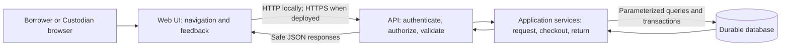
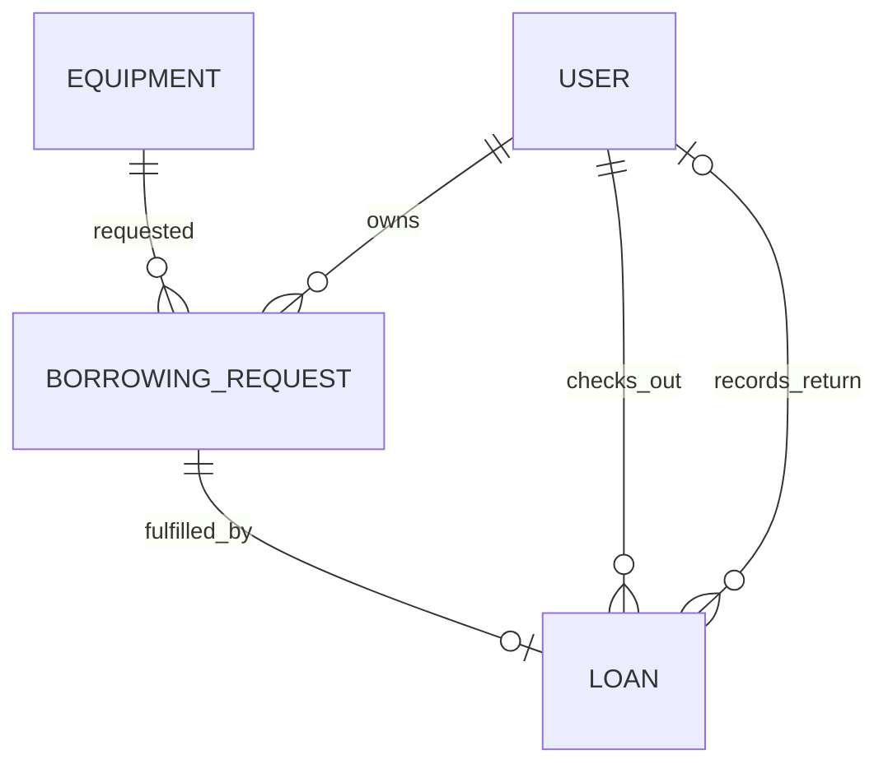

# System-Level Design Specification (SDS)

> **Project:** PEW-DIY — D.I.Y. Room Equipment Borrowing System
>
> **Deliverable:** D1-03 Part C — System-Level SDS | **Issue:** [#3](https://github.com/Peepipat-Suesoongnuen/PEW-DIY/issues/3)
>
> **Revision:** 2, 2026-11-04 | **Status:** Draft for team decision and peer review
>
> **Baseline:** [SRS](srs.md) rev 2 and [Feature Inventory](features.md) rev 1, present at commit `9d3c57b`
>
> **Language:** English (SRS A-07). This is a design specification; no application, migration, authentication mechanism, or deployment is implemented by this document.

## 1. Sources, Status, and Design Boundaries

The requirements baseline remains in the [SRS](srs.md), feature ownership in the [Feature Inventory](features.md), and requirement-to-sprint mapping in the [Traceability Matrix](traceability.md). This SDS defines their system-wide design implications; it does not replace their requirement text or introduce new product capabilities. Detailed feature endpoints, payload fields, AC, test IDs, and STS belong to [D1-05]. Application implementation belongs to [D1-06].

| Source checked | Relevant sections | Use in this SDS |
|---|---|---|
| `project_deliverable_1_v1.pdf` | §3.3, PDF p.3 | Part C content: architecture/data/UI/API/access/configuration design |
| `group_work_specs_v1.pdf` | §5.1–§5.3, PDF pp.3–4; §8.1, PDF p.10 | Logical layers, durable storage, identity/access, design now and Docker/GCP implementation in Lab 5 |
| [Issue #1](https://github.com/Peepipat-Suesoongnuen/PEW-DIY/issues/1), [Issue #2](https://github.com/Peepipat-Suesoongnuen/PEW-DIY/issues/2) | Issue bodies and comments checked 2026-11-04; both closed, no comments | Upstream scope; resulting local SRS and Part B documents supply stable IDs |
| [Issue #3](https://github.com/Peepipat-Suesoongnuen/PEW-DIY/issues/3) | Scope, tasks, AC-C-01–AC-C-06 | This document's deliverables and unresolved stack/session choices |
| [Repository instructions](../AGENT.md) | §2–§3, §11–§16 | Verify actual stack, preserve requirements, distinguish proposals and open questions |

The PDF files were read from the team's local `D:/Software_Engineering/PEW-DIY/lab-document/` directory; they are not tracked repository files. For the final D1 hand-in, include the complete Part C content in the combined PDF as required by `project_deliverable_1_v1.pdf` §4.1; a repository link alone is insufficient.

**Status vocabulary:** **Confirmed** means supported by the SRS or the course documents; **Proposed** means an engineering choice in this draft awaiting team review; **Open** means a decision is still required. All new implementation choices below are **Proposed**, even when phrased as instructions for a future implementation. They are not claims about existing software.

**Reconciliation:** Issue #1/#3 and the older `AGENT.md` snapshot still describe some decisions as open. SRS A-03/BR-07 already fix the seven-calendar-day loan period, and A-04/BR-03 already fix the quantity interpretation of exclusive-item protection. Those decisions are carried forward. SRS OQ-01/OQ-02 and the stack/session choices remain open.

## 2. Technology Stack and Architecture

### 2.1 Verified Stack Status and Selection Criteria

The local baseline contains documentation only: no application source, runtime manifest, dependency lockfile, database schema, or Lab 1–4 application evidence. Neither checked PDF nor Issue #1/#2 identifies a mandatory framework/database. **No exact technology stack can currently be recorded as selected.** This is an explicit AC-C-01 gap, not permission to infer a stack from another project in the workspace.

| Layer | Confirmed responsibility | Open selection and evidence needed |
|---|---|---|
| Web UI | Browser interface for F-01–F-09, validation feedback and role-aware navigation | Framework or server-rendered UI, language and supported version; use actual Lab experience if supplied |
| API/application | Authentication, authorization, validation, domain rules and transactions | Runtime, framework, maintained auth/hash libraries, test runner and supported versions |
| Database | Persistent users, catalog, requests and loans; enforce integrity and atomicity | Engine/version, driver or ORM, migration tool, locking/isolation behavior |
| Identity transport | Login/current-user/logout under FR-01–FR-05 | Server session versus token design, transport, expiry and revocation policy (§7) |

**Proposed selection approach:** reuse a team-familiar Lab stack if its actual code/configuration is provided. Otherwise compare a browser UI plus API framework and transactional relational database against an integrated web framework with the same logical responsibilities. A relational model is proposed because foreign keys and checkout transactions directly support the ownership and quantity invariants; a different database needs an equally explicit consistency strategy. No named framework, vendor, package version, or runnable setup command is asserted here.

Before [D1-05] is baselined, record the team's exact selections and rationale in this table, pin supported dependency versions in implementation manifests, and replace the setup outline in §4 with verified README commands. Criteria are team familiarity, testability of protected APIs, atomic checkout, reproducible migrations/seed, and later Docker/GCP suitability. Stack approval is recorded as SDS-OQ-01 in §10.

**Update (revision 3 — SDS-OQ-01/02 resolved):** the team selected and implemented the stack below (decision D1/D2, 2026-11-03/04; implemented in PR #22, merged). The status text above is retained as the historical record at revision 1.

| Layer | Selection (revision 3) | Evidence |
|---|---|---|
| Runtime/framework | Node.js 24 + TypeScript 7 + Express 5 | PR #22 implementation; `package.json`/`package-lock.json` (pinned) |
| Database | PostgreSQL 17 (`pg` driver; versioned SQL migrations) | PR #22 `server/src/db` |
| Password hashing | argon2id via `@node-rs/argon2` | PR #22 `server/src/services/password.ts` |
| Identity transport | Server session + HttpOnly cookie (SameSite=Lax) + trusted-origin anti-CSRF; idle/absolute expiry; durable revocation in DB | PR #22 `server/src/services/session.ts`, `auth-routes.ts`; tests TEST-F01-07/08/15/16 |
| Test tooling | Vitest + Supertest | PR #22 `server/tests` (39 tests) |

**Update (UI-02, Issue #33 — frontend selection recorded per ARCH-01 P1 gate):**
the Web UI layer is now selected and implemented: **React + Vite + TypeScript +
Tailwind CSS v4 (CSS-first `@theme` tokens) + Lucide Icons** (Approved team
decisions; ARCH-01 proposal PR #29). The built client (`client/dist`) is served
by the same Express application (SPA history fallback for non-`/api` HTML
navigations; legacy `.html` pages coexist until migration phase P4 — ARCH-01
§12.1). Component/page tests: Vitest + Testing Library (`client/src/test`);
Core UI E2E: Playwright (`e2e/`, three confirmed viewports). Evidence:
`docs/sprints/sprint-1/ui-02-evidence.md`.

### 2.2 Logical Architecture — Proposed Modular Monolith

The course permits a modular monolith: UI, API/application, and database are logical responsibilities, not a requirement for three servers or containers. One application can serve the UI and API; the database remains a durable store.

**Physical layout (revision 3, FIX-A):** the repository separates frontend and backend directories — `client/` (frontend application; structure prepared, framework not yet chosen — the framework decision belongs to UI work) and `server/` (`server/src` application code: config/db/routes/services; `server/tests` tests, kept outside the build output). This is a directory-level separation of the same logical layers below; **the deployment topology is unchanged** — one application container serves UI and API (§8.2, Lab 5 R-01).



| Component | Responsibility and trust boundary | Requirement / feature basis |
|---|---|---|
| UI | Display API state and helpful input checks; provide no authoritative stock, role, borrower ID, due date, or loan status | FR-03, FR-06/07, F-01–F-09 |
| API boundary | Resolve authenticated principal, allow-listed inputs, role and record ownership; return safe errors | FR-01–FR-05, NFR-01/02, F-01 |
| Application services | Enforce borrowing/checkout/return rules using current DB state; obtain time from a controlled server clock | BR-01–BR-09, F-03–F-07 |
| Data access | Parameterized access, atomic operations, FK/check/uniqueness constraints and ownership-scoped queries | BR-03/11, NFR-04/05/06 |
| Database | Persist committed state independently of browser and application process; reject structural integrity violations | FR-08/11/14/15, BR-11, NFR-04 |

Keep identity/access, catalog/availability, borrowing/loans, and later reporting as modules within the application. Do not add microservices, external messaging, real data, or an approval subsystem. Prefer one browser origin for UI and API; if separate origins are selected, explicitly allow only configured origins and document credential/CORS behavior in [D1-05].

## 3. Data Model and Consistency

### 3.1 Proposed Logical Entities

Field names and logical types below are design proposals, not an implemented SQL/ORM schema. Primary-key representation (integer/UUID), text lengths and migration syntax await SDS-OQ-01. Every FK is required unless marked optional. No individual serial-number entity is introduced (SRS A-01).

| Entity | Principal fields | Integrity, ownership, and use |
|---|---|---|
| **User** | `id` PK; `username` text; `password_hash` text; `role` constrained code | Unique username under a documented normalization policy; exactly one role, `BORROWER` or `CUSTODIAN`; never expose hash in responses. Seeded accounts; no registration feature (FR-01–FR-05, BR-10). |
| **Equipment** | `id` PK; `name`, `description`, `category` text; `quantity_total` integer; proposed later `catalog_status` | Required catalog fields; `quantity_total >= 0`. Availability is derived (§3.3). Retirement/status semantics are a Sprint 2 proposal tied to A-10/FR-09, not a decided repair workflow. |
| **BorrowingRequest** | `id` PK; `borrower_id` FK User; `equipment_id` FK Equipment; `quantity_requested` integer; `created_at` timestamp | `quantity_requested > 0`; permitted maximum depends on OQ-02. Owner is the authenticated Borrower, never a trusted client-selected user. Status is proposed as `SUBMITTED` or `CHECKED_OUT`, derived from whether its Loan exists. No approval status (FR-11–FR-13, A-02). |
| **Loan** | `id` PK; `request_id` unique FK BorrowingRequest; `quantity_borrowed` integer; `checked_out_by` FK User; `checkout_at` timestamp; `due_on` date; `returned_at` optional timestamp; `returned_by` optional FK User | `quantity_borrowed > 0`. Borrower/equipment come from the linked request, preventing mismatched duplicate ownership fields. Service checks checkout actor is Custodian. Return fields apply from Sprint 2; final return accounting depends on OQ-02 (§3.4). Active Loan is a view of Loan state, not a second independently writable entity (FR-14–FR-17). |

**Role representation:** the two role codes are a constrained field on User; a separate Role table is optional, with the same two permitted values and one role per user. No role-management API or multi-role account is proposed.

**Loan relationship proposal:** one request concerns one equipment type and is fulfilled by at most one loan for the requested quantity. This prevents a repeated checkout of the same request from creating another loan. Split fulfillment, quantity changes at checkout, and per-borrower limits are not assumed; [D1-05] must confirm the quantity contract with OQ-02. Do not hard-code either `quantity = 1` or unlimited multi-unit loans as a confirmed rule.



All links back to User/Equipment preserve history: do not cascade-delete requests/loans when catalog records change. A loan's borrower/item are retrieved through its request. A Custodian's `checked_out_by`/`returned_by` is actor attribution, not borrower ownership. Database FK checks cannot establish user roles alone; the service must validate roles before writing.

### 3.2 Lifecycle and Direct Checkout

```mermaid
stateDiagram-v2
    [*] --> SubmittedRequest: Borrower submits; availability checked
    SubmittedRequest --> ActiveLoan: Custodian checkout; availability rechecked
    ActiveLoan --> ReturnedLoan: Custodian return, Sprint 2
```



The diagram shows domain progression; request and loan remain distinct persisted records. A submitted request expresses intent and — **Confirmed by team decision (Direction A, 2026-11-06; SRS BR-12/A-11)** — does not reserve units or reduce availability; only a committed Active Loan reduces Available Quantity. Concurrent requests can therefore outnumber stock; successful request creation does not promise successful checkout. Checkout rechecks availability and may reject a previously submitted request. No separate approve/reject/cancel/expiry step exists in Sprint 1; per the same team decision, an approval workflow is added in **Sprint 2 only** (specification deferred to the Sprint 2 contracts) and its pending requests still do not reserve units.

### 3.3 Availability Invariant and Checkout Transaction

**Confirmed basis:** SRS A-01/A-04, BR-02/03. **Proposed representation:** derive availability from persisted loans rather than storing a second mutable `quantity_available` counter:

```text
held(item)      = sum(quantity still held by each active loan for item)
available(item) = Equipment.quantity_total - held(item)
invariant      = 0 <= held(item) <= Equipment.quantity_total
```

Under full returns, an active loan contributes all `quantity_borrowed`; a fully returned loan contributes zero. If partial returns are chosen, use the remaining-held accounting in §3.4. Do not hide corruption with `max(0, available)`; reject invalid writes and investigate inconsistent records. For a single-unit item, positive integer quantities and this invariant allow at most one active loan.

**Proposed transaction protocol** (BR-02/03/07/11, NFR-05/06):

1. Authenticate and require Custodian. Load the request's immutable equipment reference; never accept borrower, due date, or actor identity from the checkout payload.
2. Begin a transaction and lock the Equipment row, then the BorrowingRequest row in that consistent order. Re-read the request, its loan relation, the current total, and committed held quantities. Reject an already fulfilled request.
3. Validate the requested quantity against the team-approved OQ-02 policy and current available quantity. Reject insufficient stock without a loan or state change.
4. Insert exactly one Loan linked to that request, with server-assigned actor/time/due date. Availability changes through the committed loan; request status is derived from the relationship.
5. Commit all writes together, then respond. Any failure rolls back the transaction. A uniqueness constraint on `Loan.request_id` also guards repeated checkout.

Every writer affecting held units or total quantity (checkout, later return, total adjustment) must use the same Equipment-first serialization protocol. The database must re-read held quantities **after** acquiring that lock with semantics that see preceding committed writers; a stale transaction snapshot is insufficient. Engine-specific implementation/isolation tests are a stack-selection gate. An in-process mutex cannot protect multiple API processes.

For example, if PostgreSQL is selected, row locks can serialize writers to the same Equipment row; the proposed implementation would use a fresh post-lock read under an appropriate isolation level and retry transaction failures safely. This is an example, not a database selection. [PostgreSQL row-level locking documentation](https://www.postgresql.org/docs/current/explicit-locking.html#LOCKING-ROWS) describes the lock behavior.

At request creation, the application validates availability from the DB before persisting the request (BR-01); use the same equipment lock to make that check and insert consistent with checkout. No inventory decrement occurs at this step under the confirmed non-reservation model (Direction A, 2026-11-06; SRS BR-12). Later quantity reductions must reject `new_total < held` under the lock. A repeated checkout returns a safe conflict and never creates a duplicate loan; after an uncertain network response the UI re-fetches request state before retrying.

### 3.4 Return, Dates, and Later-Sprint Extensions

**SRS OQ-02 remains Open:** permitted request/loan quantity, per-borrower limits, and return semantics must be decided together.

| Alternative awaiting team decision | Data and consistency impact |
|---|---|
| Full-quantity return only | `returned_at`/`returned_by` are set atomically when all borrowed units return. Loan remains active until that event. A repeat return changes nothing and is rejected as a conflict. |
| Partial returns allowed | Add persisted returned-quantity accounting (e.g., Return records with loan/quantity/Custodian/time). Enforce `0 <= total_returned <= quantity_borrowed`; held quantity is `quantity_borrowed - total_returned`. Close only when held reaches zero. Record return and availability effect in the same locked transaction. |

The partial-return schema is conditional, not part of the fixed core ERD. If selected, earlier partial returns live in Return records; keep Loan `returned_at`/`returned_by` unset until all units have returned. The loan stays active, contributes its remaining held quantity, and remains eligible for overdue calculation until closure. Either alternative must satisfy BR-09; closing a partially returned loan would incorrectly free held units. Do not implement a partial-return contract before OQ-02 is resolved.

**Proposed date representation:** store event timestamps as UTC instants; calculate `due_on` as the checkout's calendar date in an explicitly chosen business timezone plus seven calendar days (A-03/BR-07). Overdue is derived as `active AND business_current_date > due_on` (BR-08); it is not a separately mutable loan status, and equality with the due date is not overdue. `APP_TIMEZONE=Asia/Bangkok` is a proposal for this university context, pending SDS-OQ-03; it is not an inferred team decision. The seven-day rule does not permit a client-selected due date or a category-specific period before OQ-03 is resolved. Date and timezone boundary tests belong in the feature contracts.

Sprint 2 adds return, overdue, catalog management/search, full history and Custodian all-loan views (F-06–F-08); Sprint 3 reporting (F-09) reads the same persisted catalog/loan data. No separate reporting database, scheduled overdue mutation, penalties, or notification service is needed by the current baseline.

## 4. Database Setup, Migrations, and Synthetic Seed

The following is the **proposed reproducible procedure**, not a list of currently runnable commands. Exact engine/tool commands are blocked by SDS-OQ-01 and belong in README when the application exists (NFR-08).

1. Install the pinned runtime/database tooling selected by the team. Configure an isolated development database and a separate test database; neither uses real university data.
2. Supply ignored local environment values using a future `.env.example` containing names/placeholders only. Validate required DB/auth configuration before accepting requests; fail with a safe message when incomplete.
3. Apply ordered, version-controlled migrations to an empty database, recording the schema version. Proposed order: User/role constraints → Equipment → BorrowingRequest → Loan/FKs/checks/unique request link → chosen auth storage. Sprint 2 adds the agreed return/retirement schema through new migrations.
4. Run an explicit, repeatable demo seed command. Use stable synthetic record keys and insert missing fixtures without resetting existing loans, stock, passwords, or role assignments on a second run. Destructive reset must be a separately invoked local/test operation, never an application startup step.
5. Start the app and verify login, catalog read, request, checkout, and read-back. Restart the app with the same store and compare persisted records. Later recreate the app container against that store to verify redeployment durability (Lab 5).

| Proposed seed fixture | Purpose / unresolved detail |
|---|---|
| Two distinct Borrower accounts and one Custodian account | Own-versus-other record tests and role-denied API calls; usernames are synthetic. Password values arrive through an ignored local/private seed procedure and are never written into tracked fixtures, this document, logs, or the deliverable PDF. |
| Small deterministic equipment catalog | Include synthetic single-unit and multi-unit totals to exercise BR-03; actual names/categories await OQ-01. Example fixtures are test/demo data, not the team's approved initial inventory. |
| Clean demo borrowing state | No pre-existing loans required for the happy path; create requests/loans through the API. Isolated tests may build deterministic held/zero-stock/rollback scenarios without mutating the demo store. |

Seed only salted password hashes; generate hashes with the selected password library from transient local input. Fixture identity/content is repeatable even though secure hash salts vary. Protect seed logs from credential/hash output. The `project_deliverable_1_v1.pdf` §4.4 private-access/seed-procedure option avoids publishing demo passwords in Git or the PDF.

**Proposed constraints/indexes:** FK-backed owner/item lookups; unique normalized username and `Loan.request_id`; positive request/loan quantities and nonnegative totals; request index on `(borrower_id, created_at)` and Equipment FK; loan lookup by request and active/due date as supported by the chosen schema. Cross-row stock limits require the transaction protocol, not merely a per-row `CHECK`. Preserve migration history; test each revision on an empty database and an upgraded fixture database.

## 5. Main Screens and Shared UI Behavior

All routes below are **proposed UI names**. Role-based visibility helps navigation; §6 controls API access regardless of the UI.

| Screen / navigation | Role and data shown | Feature / allocation |
|---|---|---|
| Login → catalog | Both roles; generic invalid-credentials feedback; fetch current-user identity after login/reload | F-01, Sprint 1 |
| Catalog → item detail → request form | Both roles read name/category/quantity/availability; only Borrower submits a request | F-02/F-03/F-04, Sprint 1; search/filter F-08 in Sprint 2 |
| My requests | Borrower, own submitted/checked-out requests only | F-04, Sprint 1 |
| My active loans | Borrower, own item/quantity/checkout/due data | F-05, Sprint 1; full history F-08 in Sprint 2 |
| Submitted requests → checkout result | Custodian, submitted requests and checkout action; show the newly created loan | F-04/F-05, Sprint 1 |
| Loan management / return / overdue | Custodian, all loans and return/overdue controls | F-06/F-07/F-08, Sprint 2 |
| Catalog management / history | Custodian catalog writes; Borrower own full history | F-08, Sprint 2 |
| Inventory reports | Custodian, inventory/loan/overdue summaries | F-09, Sprint 3 |

Provide visible navigation appropriate to the current server-returned role and an accessible logout action. Do not expose a general Custodian all-loans list in Sprint 1 merely because the checkout response includes a created loan (FR-18 is Sprint 2).

| State | Proposed shared behavior |
|---|---|
| Validation | Show field errors next to inputs, preserve safe entered data, and repeat validation on the server. Quantity choices await OQ-02; never calculate the authoritative due date/availability in the browser. |
| Loading / mutation | Indicate loading, prevent duplicate form submission while pending, and update from the committed API response. Do not show checkout success before commit. |
| Empty | Distinguish an empty catalog, no own requests/loans, and zero availability. Zero availability is a valid state; disable request affordance with an explanation. |
| Conflict | Explain that stock or request state changed; re-fetch current availability/request state. No automatic repeated checkout after an ambiguous response. |
| Unauthorized / forbidden | On 401 clear stale identity/private views and return to login; on 403 show denied access without the target record. Clear private cached data on logout/user change. |
| Unexpected error | Show a generic retry message and request ID if provided; no server stack, SQL, credentials, or private record content. |

## 6. API Conventions and Role/Record Access

### 6.1 Proposed API Conventions

Use a consistent prefix such as `/api`, JSON request/response bodies, and resource-oriented names such as `equipment`, `requests`, and `loans`. Authentication operations cover login, current-user and logout. These names are **proposals**, not final endpoint contracts; exact paths/methods/payloads, pagination and test IDs are fixed in [D1-05].

Success returns a documented `data` object/list (or an explicitly documented empty response). Errors use a consistent safe envelope, for example:

```json
{
  "error": {
    "code": "INSUFFICIENT_AVAILABILITY",
    "message": "Equipment is no longer available.",
    "requestId": "synthetic-request-id"
  }
}
```

| HTTP result | Proposed convention |
|---|---|
| 200 / 201 / 204 | Successful read/action, newly created resource, or documented no-content action respectively |
| 400 | Malformed JSON, wrong types, missing fields, or rejected input fields; optional safe field-error list |
| 401 | Missing/invalid/expired/revoked authentication, or generic invalid login; no private response data |
| 403 | Authenticated wrong role or cross-borrower access, consistent with NFR-02; never include the other borrower's record |
| 404 | Resource absent within an authorized scope; perform ownership checks before returning private information |
| 409 | Availability or lifecycle conflict, including repeated checkout/return; no partial writes |
| 500 / 503 | Unexpected failure or temporary service/DB unavailability; generic safe response, redacted internal diagnostics |

Validate allow-listed fields and supported content types; do not bind incoming JSON directly to persistence models. User/role/owner, checkout actor, due date, derived availability and lifecycle fields are server-controlled. Parameterize DB queries. Authenticate before protected reads/writes, then authorize role and record scope, then validate/apply domain operations. No private record is returned in a rejection. Log request identifiers and safe outcome codes; omit passwords, hashes, tokens, cookies and private response bodies.

### 6.2 Role × Operation × Record-Scope Matrix

**Confirmed role/ownership basis:** FR-04/05, BR-04/05/06. **Proposed mapping:** resource scopes/response limits below implement that basis without widening product scope. `Denied` means a backend denial even when the caller constructs an API request manually. For Sprint 2/3 rows, the permissions apply when those operations are implemented; this table does not create them in Sprint 1.

| Operation | Unauthenticated | Borrower | Custodian | Feature / sprint |
|---|---|---|---|---|
| Login | Submit credentials; generic denial if invalid | Same | Same | F-01 / S1 |
| Current-user / logout | No protected identity; no private data | Own identity/current session only | Own identity/current session only | F-01 / S1 |
| Read equipment / availability | Denied | Catalog scope | Catalog scope | F-02/F-03 / S1 |
| Create borrowing request | Denied | Own request; server assigns borrower | Denied; no on-behalf borrowing capability is in scope | F-04 / S1 |
| List/read requests | Denied | Own records only | Submitted requests needed for checkout | F-04 / S1 |
| Checkout | Denied | Denied for every request, including own | Submitted request, current stock/quantity rules; actor is current Custodian | F-05 / S1 |
| Read own active loans | Denied | Own records only | Created loan in checkout response; general all-loans view allocated below | F-05 / S1 |
| Read all active loans / record return | Denied | Denied | All room loans; return only a loan with held quantity | F-06/F-08 / S2 |
| Own complete borrowing history | Denied | Own records only | No new history capability implied; use authorized staff loan views | F-08 / S2 |
| Create/edit/retire equipment or adjust quantity | Denied | Denied | Room catalog; preserve existing held units/history | F-08 / S2 |
| Search/filter catalog | Denied | Catalog scope | Catalog scope | F-08 / S2 |
| Overdue list | Denied | Denied | Room overdue active loans | F-07 / S2 |
| Inventory reports | Denied | Denied | Room inventory/loan summaries | F-09 / S3 |

Borrower list queries always include the authenticated owner predicate. Detail/action lookups check ownership through BorrowingRequest (Loan → Request → Borrower), independent of URL/body IDs. A Borrower requesting another Borrower's ID receives 403 without the row. The exact denial envelope must be uniform and must not disclose names, request contents or loan contents. Never trust a UI-supplied role, `borrower_id`, or a guessed record identifier. The single-room staff scope follows SRS A-08 as a working assumption, not a multi-room authorization design.

Feature contracts must exercise every existing protected endpoint with unauthenticated requests, wrong-role calls, and cross-owner identifiers where applicable. Use two Borrowers to test both list filtering and detail access. Test Custodian checkout independently of hidden buttons. Do not add Sprint 2 return/catalog-write endpoints solely to claim Sprint 1 negative-test coverage.

## 7. Credentials and Authentication Lifecycle

### 7.1 Shared Requirements and Proposed Credential Handling

FR-01–FR-03, BR-10 and NFR-03 require real login/current-user/logout and salted password hashes. Use a maintained password-hashing library, verify via its comparison function and never return/log the stored hash. **Proposed algorithm candidate:** Argon2id where the selected runtime supports it; library/version and benchmarked cost remain team decisions. Fast general-purpose hashing or reversible password encryption is not an acceptable substitute. See [OWASP Password Storage guidance](https://cheatsheetseries.owasp.org/cheatsheets/Password_Storage_Cheat_Sheet.html).

Login accepts credentials over HTTPS when deployed and returns the same safe error for unknown user and incorrect password. Resolve role/identity from trusted server state. Current-user returns only the safe identity fields needed by the UI; every protected operation independently validates authentication and authorization. Credential fixture handling follows §4; no real accounts or third-party identity integration are introduced.

### 7.2 Open Choice: Server Session Versus Tokens

No checked source selects session/token strategy. These are alternatives for SDS-OQ-02, not two mechanisms to implement together:

| Lifecycle | Proposed server-session option | Proposed token option |
|---|---|---|
| Creation | After credential verification, generate a new unpredictable opaque session ID; associate user, creation/expiry and revocation state in durable/shared session storage | Issue signed token with validated subject/expiry and, if needed, a server-tracked session/token identifier; signing algorithm/key policy must be fixed |
| Transport | Cookie with `HttpOnly`, `Secure` when deployed, appropriate `SameSite`/path; protect state-changing requests against CSRF | Document bearer-header or protected-cookie transport, safe client storage and XSS considerations; cookie transport still needs CSRF controls |
| Each protected request | Validate session existence, expiry/revocation and current user/role | Validate signature/allowed algorithm/issuer/audience as applicable, expiry, server revocation/session status and trusted role policy |
| Expiry | Enforce documented idle and absolute expiry on the server | Enforce access-token expiry and explicit refresh policy if refresh exists; refresh tokens are not assumed by this SDS |
| Logout | Invalidate the server session and clear browser cookie/private UI state; replay of its old ID is denied | Revoke the current session/token identifier server-side and clear client state; specify how already issued access credentials are rejected |
| Scaling/durability | DB or another approved shared store; process-only memory is insufficient for a multi-instance deployment | Revocation/session state must also be shared if used; token-only validation cannot provide immediate revocation by clearing the browser |

**Proposed tradeoff:** a server session is the simpler candidate for a single browser application requiring observable current-session invalidation, while tokens require explicit revocation/storage choices. The team must approve one. A purely stateless JWT that remains valid after client-only logout does not meet the proposed FR-02 replay-denial behavior; do not label token deletion as server invalidation. Session ID renewal, server expiry, logout and cookie attributes should follow the [OWASP Session Management guidance](https://cheatsheetseries.owasp.org/cheatsheets/Session_Management_Cheat_Sheet.html).

Exact timeout durations, cookie names, token claims/keys, refresh behavior, CSRF mechanism and session schema remain open until SDS-OQ-02 is resolved. [D1-05] must document creation → valid current-user → expiry/revocation → denied old credential, plus logout replay and browser identity clearing. Neither option's implementation or security tests are claimed complete here.

## 8. Configuration and Deployment Design

### 8.1 Proposed Configuration Inventory

Names below are logical proposals to map to the selected runtime, not existing application variables or an `.env.example` implementation. No real values are included.

| Configuration | Classification / purpose |
|---|---|
| `APP_ENV`, `PORT`, `LOG_LEVEL` | Non-secret environment/HTTP/log settings; validate allowed values |
| `DATABASE_URL` or equivalent host/name/user/credential inputs | Secret if credentials are included; correct dev/test/deployed durable store |
| `APP_ORIGIN`, optional explicit allowed origins | Non-secret origin and CORS/credential/CSRF configuration, matching chosen browser topology |
| `APP_TIMEZONE` | Non-secret business date zone; `Asia/Bangkok` is proposed, pending SDS-OQ-03 |
| Session idle/absolute timeout inputs | Non-secret durations, required only for the chosen session policy; values pending SDS-OQ-02 |
| Session-protection secret or token signing key, if required by selected library | Secret; choose only inputs used by the selected auth mechanism, no hard-coded defaults |
| Demo credential seed inputs | Secret local/private inputs used only during explicit seed; never logged or stored as plaintext fixtures |
| Deployment project/region/service/database/image identifiers | Non-secret identifiers to record after Lab 5 choices; not proof that resources exist |

Use ignored local configuration and a future tracked `.env.example` with placeholders; inject deployed secrets through an approved secret facility. Never bake credentials into an image, Git file, PDF, browser bundle, error or log. The app's database account uses only required data permissions; schema changes run through a controlled migration step rather than giving every app instance unrestricted schema rights.

### 8.2 Proposed Docker/GCP Topology — Lab 5 Implementation Pending

**Confirmed course boundary:** Part C needs a feasible design now; Docker, mandatory CI and real GCP setup are later work. No Dockerfile, CI workflow, GCP resource or actual deployment is delivered by this issue.

| Component | Proposed plan and rationale | Open decision |
|---|---|---|
| Application packaging | One reproducible application image can serve UI/API for the modular monolith; configure at runtime and bind the platform HTTP port | Selected stack determines build/start procedure |
| Container image storage | GCP Artifact Registry or the approved Lab 5 registry, tied to release commit/image identity | Project/access/region and actual lab guidance |
| HTTP application hosting | Candidate: Cloud Run with HTTPS ingress; alternative: container on Compute Engine under lab guidance | Service choice, cost/access and operational fit remain SDS-OQ-04 |
| Persistent database | Candidate for a relational engine: Cloud SQL; VM-hosted DB on durable disk is another option requiring backup/operations work | Engine, connection method and storage lifecycle |
| Secret/configuration delivery | Approved secret facility (candidate: Secret Manager) plus non-secret runtime configuration | IAM/access and chosen auth/DB requirements |

Cloud Run's writable container filesystem does not survive instance shutdown, so a DB file inside that filesystem cannot be the durable store. Its ingress must listen on the configured `PORT` at `0.0.0.0`. These constraints support the proposed external-store topology; they do not select Cloud Run for the team. [Cloud Run container runtime contract](https://docs.cloud.google.com/run/docs/container-contract).

If the team selects Cloud Run with Cloud SQL, use the documented connection mechanism and least-privilege service identity; plan connection limits for app scaling. This pairing is a feasible candidate, not provisioned infrastructure. [Cloud SQL connections from Cloud Run](https://docs.cloud.google.com/sql/docs/postgres/connect-run).

On any topology, replacing the application image/container must preserve the same durable catalog, requests and loans (BR-11/NFR-04). Run migrations as an explicit deployment step, never reset/reseed production on every startup. Record actual deployed version, configuration procedure, migration result and read-back evidence after Lab 5 deployment exists. UI screenshots alone do not prove durability.

## 9. Architecture Decision Register and Verification Handoff

`AD-C-xx` identifies Part C design decisions/proposals without changing SRS `A-xx` IDs. Only baseline-backed rows are Confirmed; new design choices await team review.

| ID / status | Decision or proposal | Rationale / consequence and baseline |
|---|---|---|
| AD-C-01 — Confirmed basis | Quantity Tracking and exclusive-item protection | SRS A-01/A-04, BR-03 → Equipment quantities and held-unit invariant; no serial-level inventory |
| AD-C-02 — Confirmed basis | Direct Checkout retains requests | SRS A-02, FR-11–FR-14 → persist intent then Custodian checkout; no approval subsystem |
| AD-C-03 — Confirmed basis | Seven-calendar-day due date | SRS A-03/BR-07 → server-assigned date; timezone representation remains proposed |
| AD-C-04 — Proposed | Modular monolith with logical UI/API/DB boundaries | Fits course §5.1 and small team; business rules remain server-side without extra services |
| AD-C-05 — Proposed | Derived availability and serialized Equipment writes | Avoid competing stock counters; enforce BR-03/NFR-05/06 with DB transactions, not browser state |
| AD-C-06 — Proposed | One request → at most one loan; ownership through request | Prevent duplicate fulfillment and inconsistent borrower/item links; quantity/split fulfillment contract awaits OQ-02/[D1-05] |
| AD-C-07 — Resolved (rev 3) | Exact stack and authentication strategy | Resolved: Node.js/TypeScript/Express/PostgreSQL + server session/cookie/trusted-origin (team decision D1/D2; PR #22) — see §2.1 |
| AD-C-08 — Proposed | Durable store separate from application lifecycle | BR-11/NFR-04 and later GCP design; no data stored only in app memory/container filesystem |

The following are **planned checks for [D1-05]/[D1-06]**, not executed tests or invented TEST IDs. [Part B traceability](traceability.md) remains the authoritative requirement/sprint allocation.

| Design concern / basis | Future verification to capture |
|---|---|
| Identity/access — FR-01–FR-05, BR-04/05/06/10, NFR-01/02/03 | Valid/invalid login; current-user and logout/expiry/replay; missing credentials; forbidden role; two-borrower list/detail ownership; hash/seed inspection |
| Catalog/request — FR-06–FR-08, FR-11–FR-13, BR-01 | Repeatable seed; list/detail availability; valid persisted request; unavailable/malformed/forged-owner request rejected without writes |
| Checkout — FR-14–FR-16, BR-02/03/07 | Authorized checkout; unavailable/repeated checkout denial; +7 calendar-day boundary; competing attempts for a single-unit item yield at most one loan |
| Persistence/atomicity — BR-11, NFR-04/05/06 | Real DB concurrency with defined repetitions; injected failure rolls back every checkout write; restart read-back; no hidden negative availability |
| Reproducibility/automation — NFR-08/09 (F-10) | Fresh setup from README within target; migrations/seed repeat; all Sprint 1 AC mapped to real tests with failure exit status |
| Later allocation | Return/close accounting and atomicity, overdue date boundaries, catalog writes/history in S2; report/performance target NFR-07 in S3; recreated-container/redeployment read-back in Lab 5 |

F-10 (Sprint 1 Integration and Verification, named system responsibility per [Part B](features.md)) coordinates the Sprint 1 checks above; the [traceability matrix](traceability.md) remains authoritative for requirement-to-feature-to-sprint allocation.

## 10. Open Decisions and Part C Acceptance Review

Existing SRS questions retain their original IDs; this SDS does not resolve or renumber them. Local `SDS-OQ-xx` IDs track additional design choices only.

| Question | Impact / next evidence required | Target |
|---|---|---|
| SRS OQ-01 | Team supplies actual initial catalog; until then fixtures remain labelled synthetic/proposed | Before Sprint 1 seed implementation |
| SRS OQ-02 | Team fixes >1 quantities, borrower limits and full/partial return together; confirm request-to-loan fulfillment contract | Before [D1-05] baseline |
| SDS-OQ-01 — stack | **Resolved (rev 3):** Node.js 24 + TypeScript 7 + Express 5 + PostgreSQL 17 + Vitest/Supertest (team decision D1; PR #22) | Closed — AC-C-01 now verifiable |
| SDS-OQ-02 — authentication | **Resolved (rev 3):** server session + HttpOnly cookie + trusted-origin anti-CSRF, idle 60 min / absolute 480 min (team decision D2; PR #22) | Closed — AC-C-04 now verifiable |
| SDS-OQ-03 — calendar policy | Approve business timezone/date boundary representation consistent with BR-07/08 | Before checkout contract/tests |
| SDS-OQ-04 — hosting | Select GCP services/storage/secret delivery after actual Lab 5 guidance and access | Design candidate now; implementation in Lab 5 |
| SRS OQ-03–OQ-06, A-08–A-10 | Keep later-sprint policy/assumptions visible; do not add category periods, penalties, damage workflow or new search requirements now | Per SRS targets |

| Issue criterion | Evidence in this draft | Honest status |
|---|---|---|
| AC-C-01 — stack, layers, communication, rule enforcement | §2, §3.3 | Layers/enforcement documented; **pending exact team-selected stack** |
| AC-C-02 — entities, relationships, constraints, ownership, migrations/seed | §3–§4 | Logical design/procedure documented; OQ-02 and stack-specific commands remain explicit gates |
| AC-C-03 — server role/record matrix | §6.2 | Documented for team/peer review; API enforcement not implemented by this issue |
| AC-C-04 — credentials and full auth lifecycle | §7 | Alternatives and lifecycle obligations documented; **pending selected mechanism and expiry/transport policy** |
| AC-C-05 — env/secrets/DB/Docker/durable deployment design | §8 | Design candidates documented; actual infrastructure is later work |
| AC-C-06 — SRS consistency and no invented resolutions | §1, §3.4, §9–§10; stable IDs throughout | Baseline decisions retained; open decisions labelled and not silently resolved |

This local document is not a claim that Issue #3 is Done. Resolve the decisions blocking AC-C-01/04, review all proposed choices with the team, and obtain independent teammate review through the repository workflow before completion. No implementation-test, CI, peer-approval or deployment result is claimed.

## 11. Revision History

| Revision | Change | Basis |
|---|---|---|
| 1 — 2026-11-04 | Initial System-Level SDS; architecture/data/UI/API/access/configuration proposals, explicit decision gaps and AC review | Local baseline `9d3c57b`, SRS rev 2, Part B rev 1, Issues #1–#3 and original course PDFs |
| 2 — 2026-11-04 | Tagged the NFR-08/NFR-09 verification row with `F-10` and added its coordination sentence for cross-document consistency with Part B; no design change | Peer review feedback on PR #17 (confirmed by reviewer); `docs/traceability.md` rows NFR-08 → F-10, NFR-09 → F-10 |
| 3 — 2026-11-05 | Closed SDS-OQ-01/02 with the team-selected stack and authentication strategy (§2.1 update block, AD-C-07, §10) and recorded the client/server physical layout with unchanged monolith deployment (§2.2) | FIX-A #23; team decisions D1/D2 (2026-11-03/04); PR #22 implementation evidence |
