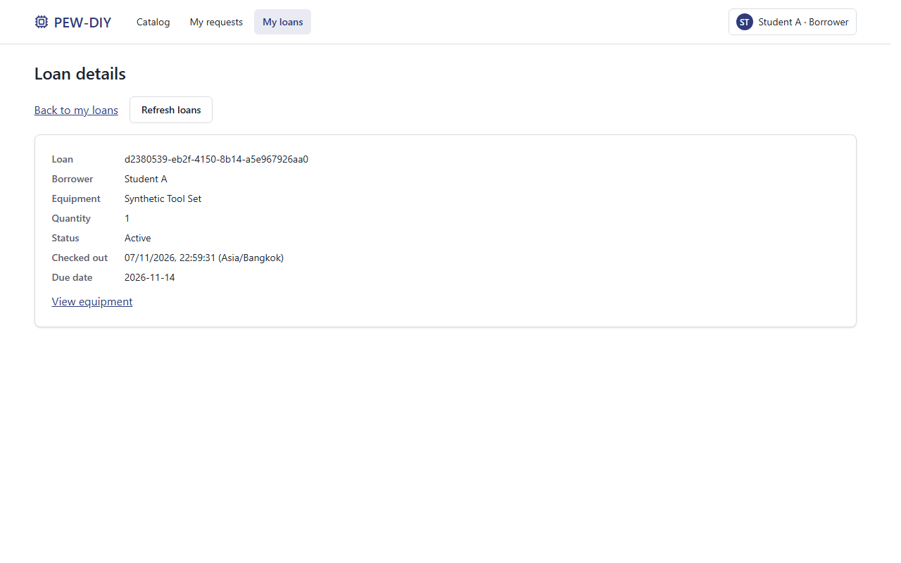
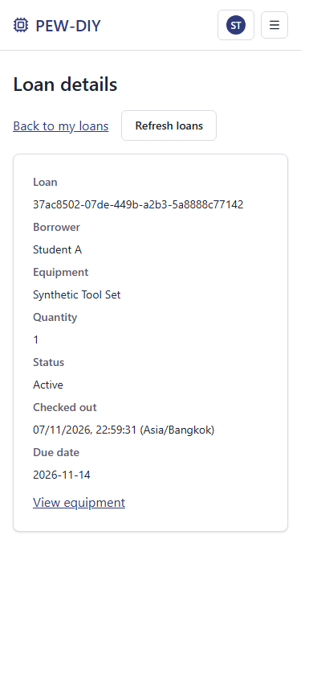

# Issue39 UI layout verification

Local verification on7 November2026 (Asia/Bangkok), branch `fix/39-ui-layout-and-loan-details`, based on `ef58fae`. These are uncommitted working-tree results, not release or clean-commit evidence. Exact baseline, changed-source fingerprints, counts and browser measurements are in [results.json](results.json). Existing F10 artifacts retain their historical source attribution.

The global root reserves a stable scrollbar gutter, with an always-scroll fallback for browsers without gutter support. Loan actions use a wrapping flex row with a16px gap. Own-loan borrower names come from the authenticated session; equipment names come from the existing catalog API. A catalog outage leaves loan data readable with an explicit unavailable-name fallback; a401 still expires the session. The shared checkout confirmation retains the resolved equipment name when the queue refreshes.

The current API does not expose another borrower's username to the Custodian checkout confirmation. That view explicitly displays `Borrower details unavailable` rather than a raw ID or the Custodian's own name. No profile API, role permission or loan response contract is added. Own-loan detail/list pages display the real authenticated borrower's username.

| Acceptance check | Actual result |
|---|---|
| Navigate catalog, loans, loan detail, requests and item detail with/without vertical scrolling | Nav/content displacement0px at390/768/1024/1280 |
| Back link and Refresh separation |16px at all four widths, above the12px requirement |
| Refresh hit target | Clicks at1%/10%/50%/90%/99% across the button trigger a successful detail GET and keep the detail URL; the back link still navigates normally |
| Readable loan data | Synthetic Tool Set / Student A shown, distinct internal equipment/borrower IDs absent from those fields |
| Regression tests | New real-browser test plus component cases for names, catalog outage,401 and detail refresh |

Client suite:74 passed/0 failed/0 skipped. Full browser suite:57 passed/0 failed/0 skipped/0 flaky. A targeted rerun of the three new project cases captures all four widths and desktop/mobile screenshots. Client typecheck/build, server build and E2E TypeScript checks passed on Node24.15.0/PostgreSQL18.4. The initial component RED run was observed in the session; no raw RED artifact is claimed. Current counts are extracted from actual JSON reporters.

The new browser test is [ui-layout.spec.ts](../../../e2e/specs/ui-layout.spec.ts). It creates its own PostgreSQL schema, synthetic identities with distinct username/ID values, real requests and checkouts, and an isolated app process. It cleans those resources after execution; product API responses are not intercepted. Desktop also tests1024px alongside1280px; the existing tablet/mobile projects cover768px/390px.

With the root README's dedicated migrated/seeded browser DB, private seed environment and built client configured:

```powershell
npm --prefix client test
npm --prefix client run typecheck
npm --prefix client run build
npx tsc --noEmit -p e2e/tsconfig.json
npm run test:e2e -- --workers=3 --retries=0
```

Target only the new regression with `npm run test:e2e -- ui-layout.spec.ts --workers=3 --retries=0`.




