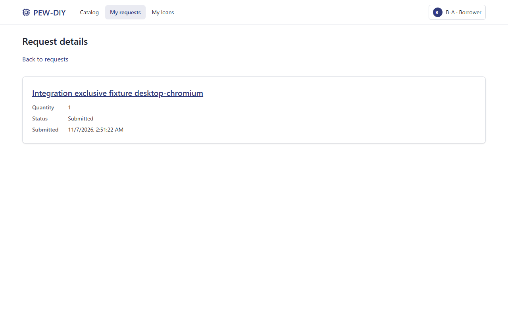
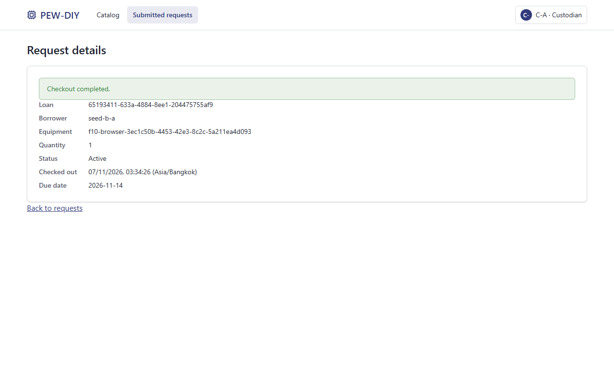
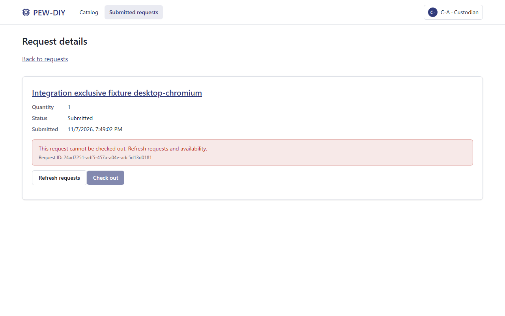
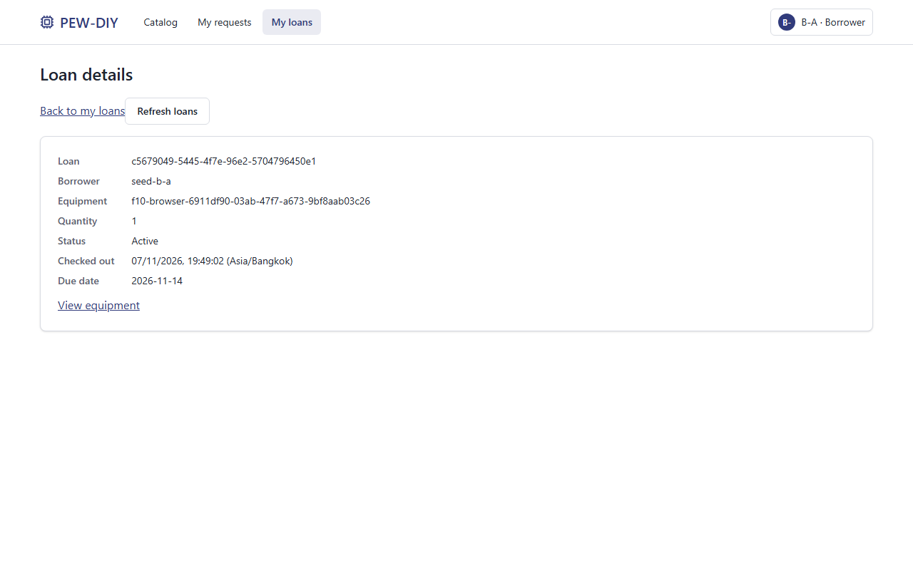
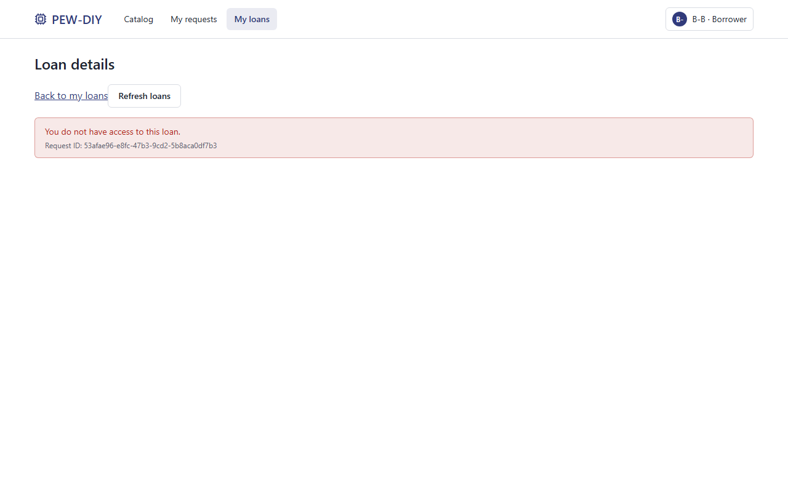
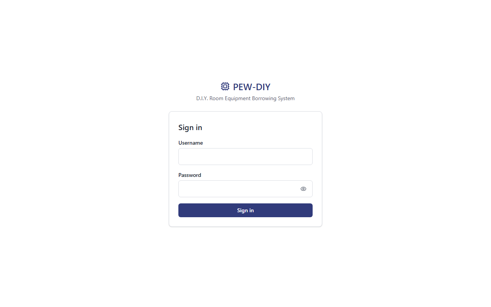

# Sprint 1 Part F evidence pack — Issue #13 / F-10

**Date:** 7 November2026 (Asia/Bangkok). **State:** PR #38 is open for review, not a main release or completed Product DoD. Submitted head: `2b76abbf7be1d6384ee4ae2dffa1808f71aeda82`, based on staging `5b064ea`. Remediation runs distinguish a working-tree candidate from a verified clean-source commit; the actual current state is recorded below. [verification.json](run/verification.json) records `head_commit`, nullable `tested_commit`, `version_kind`, dirty source files and canonical source fingerprints. A null tested_commit is explicitly not commit-verification. The user committed/pushed the original work and opened [PR #38](https://github.com/Peepipat-Suesoongnuen/PEW-DIY/pull/38); no merge/main release/tag has occurred.

Original `project_deliverable_1_v1.pdf` pp.5–7 (§3.6/§4.2) and `group_work_specs_v1.pdf` p.5 Theme2 were read from the supplied `lab-document/` directory. This pack supplies Part F source artifacts for the final self-contained A–F PDF; it does not claim the complete submission PDF has been assembled or submitted.

## Navigation for Part F assembly

| Required evidence | Artifact to embed/read |
|---|---|
| Version, actual build/test outcomes and limitations | This page and [verification.json](run/verification.json) |
| Normal persisted journey, rule rejection, identity/access | Scenarios/screenshots below; actual per-project [desktop](run/demo-desktop-chromium.json), [tablet](run/demo-tablet-chromium.json), [mobile](run/demo-mobile-chromium.json) records |
| Every AC → planned TEST → actual file/name → result | [Generated57-row AC results](run/ac-results.md), [reviewable mapping](../../../scripts/sprint1-ac-map.json) |
| Domain and security test excerpts; authentic TDD history | [test-excerpts.md](test-excerpts.md) |
| Issue/contract/branch/review/staging chains, both students, AI disclosure | [workflow-and-contributions.md](workflow-and-contributions.md), [verified metadata](workflow.json) |
| Setup timing and reproduction | [root README](../../../README.md), [setup.json](run/setup.json) |
| Human gates and proposed release | [release-handoff.md](release-handoff.md) |

For the PDF, embed the selected images, actual AC table and excerpts directly; external links alone are not the submission. Add actual page numbers to the A–F navigation after assembling the full document, and use the eventual reviewed release SHA throughout. Do not relabel this candidate's outputs as release-commit results.

## Actual automated results

| Command/check | Passed | Failed | Skipped | Evidence |
|---|---:|---:|---:|---|
| Server Vitest suite | 164 | 0 | 0 | [server.json](run/server.json), [log](run/server-tests.txt) |
| Client Vitest suite | 70 | 0 | 0 | [client.json](run/client.json), [log](run/client-tests.txt) |
| Playwright, desktop/tablet/mobile Chromium | 54 | 0 | 0 | [browser.json](run/browser.json), [log](run/browser-tests.txt); zero flaky cases |
| Server build, client typecheck/build | PASS | 0 | — | [server build](run/server-build.txt), [typecheck](run/client-typecheck.txt), [client build](run/client-build.txt) |
| Application AC mapping | 49/49 | 0 missing | 0 | All F-01–F-05 application AC map to executed passing cases; process approval is separate |
| Full contract mapping | 57 result rows | 0 missing | — | F-10 has3 PASS and5 PARTIAL rows because human/release requirements remain |
| Intentional isolated runner-failure probe | Expected failure observed | 1 deliberate assertion | 0 | [probe JSON](run/runner-failure-probe.json): nonzero exit; excluded from product-suite counts |

Environment: Windows, **Node24.15.0**, **PostgreSQL18.4**, Vitest5.1.0, Playwright1.64.1; exact timings/commands are in `verification.json`. Two temporary schemas are created inside the dedicated test DB, migrated before test discovery, and removed afterward. Browser seed passwords are generated privately per run. No dependency was added; lockfiles remain unchanged.

The49 new F-10 server cases include real production HTTP probes of every protected route for anonymous/invalid/expired/revoked sessions, wrong-role/owner manipulation, secure cookie attributes, actual seed reruns, and app-process restart with reauthentication and revoked-session replay. Including the route-inventory consistency test, this is **49 new cases** relative to the115-case F-05 suite. The exact runner total is164. Browser adds three complete integrated journeys (one per viewport) to the51-case F-05 suite.

The initial mapping audit rejected three stale name references although all suites passed; the mapping was corrected to actual reported names. Assertions were not weakened. A rehearsal attempt on an already seeded DB was not used for this issue's evidence; the F-10 runner deliberately provisions virgin schemas so stale credentials/data cannot manufacture a pass.

Local DB evidence is PostgreSQL18.4. PR #37's [reviewer](https://github.com/Peepipat-Suesoongnuen/PEW-DIY/pull/37#pullrequestreview-5804916583) separately reports115 server/70 client/51 browser passes on fresh PostgreSQL17.11 at `70e7b5e`. That verifies the earlier F-05 head in the reviewer's environment, **not** the new F-10 suite on PostgreSQL17. No combined/relabeled result is claimed.

## Demonstration scenarios — expected versus actual

All scenarios below run in `e2e/specs/sprint1-integration.spec.ts`, test `TEST-F10-01/02: complete UI/API/DB journey, exclusive rejection, ownership and logout`. Their starting state is a fresh browser-test schema with privately seeded B-A/B-B/C-A and a unique synthetic total1 item per viewport. They use real UI/API/PostgreSQL, with no intercepted business responses.

| Scenario / IDs | Role and steps | Expected | Actual |
|---|---|---|---|
| Normal request → checkout → own loan; F-01–F-05, AC-F10-01 | B-A logs in, opens catalog/item and submits qty1; B-B submits a competing qty1; C-A opens the submitted queue and checks out A; B-A logs in again and reloads own loan detail | Both requests201 without reserving stock; checkout201 creates one durable loan, request CHECKED_OUT, available0; returned API IDs/quantity/date equal fresh DB rows | PASS on all3 viewports; own detail survives reload; committed Loan and DB agree |
| Meaningful stock/duplicate rejection; AC-F05-02/03/04, AC-F10-02 | C-A repeats the fulfilled request, then uses the still-submitted competing request | Repeat409 ALREADY_CHECKED_OUT; stale competing checkout409 insufficient, no second loan or negative stock | PASS; UI shows conflict; fresh SQL count is exactly1 |
| Identity/access; AC-F01-04/05/06/08/09/12, AC-F10-02 | B-A tampers local role storage and calls checkout; logs out and replays the old cookie; B-B calls A's request/loan IDs and opens A's loan page | Trusted identity stays BORROWER; checkout403; logout replay401; foreign IDs403 without private data | PASS; safe forbidden UI recorded; API assertions enforce every denial |
| Durable restart; AC-F10-03, BR-11 | In `server/tests/sprint1-integration.test.ts`, snapshot actual request/loan/stock, log out A, stop production app, start new process on same DB, reject replay on every protected route, reauthenticate and read again | Identical persisted IDs/owner/item/quantities/dates/stock; no reset/reseed | PASS against actual `server/src/index.ts` processes |

Selected desktop evidence (equivalent tablet/mobile screenshots are retained under `run/screenshots/`):

**Borrower persisted request — F-04 / AC-F04-01/08.**

**Custodian committed checkout — F-05 / AC-F05-01/06/10.**

**Meaningful unavailable-stock rejection — F-05 / AC-F05-02.**

**Borrower own loan after reload — F-05 / AC-F05-08.**

**Forbidden cross-owner access — F-01/F-05 / AC-F01-09, AC-F05-08.**

**Logout returns to sign-in — F-01 / AC-F01-06/11.** Backend replay denial is separately asserted401.

## Setup, concurrency and artifact audit

The [timed setup](run/setup.json) starts with installed Node/npm/PostgreSQL/tar, then uses a fresh source directory, fresh dev/test databases, actual `npm ci` for both packages, Chromium install/check, configuration, migrations, seed, builds and application startup. Seeded login200, catalog200 with3 items and the built React shell were checked. The latest actual duration and target check are in `setup.json`. The original historical run was61.812 seconds, below900 seconds; reruns are separate records, not relabeled as that original run. Host package/browser caches may be warm; this is not a fresh OS measurement. Other-student README repetition remains PENDING.

The full suite retains all50 independent distinct-request races plus one same-request race between two separate Node workers with separate DB pools and an IPC barrier. [races.json](run/races.json) records all51 outcomes, actual server version and worker PIDs. Every race has one201/one409 and verifies one loan, held1, available0. The F-05 after-insert barrier also verifies independent readers cannot see uncommitted stock consumption and rollback leaves no partial state.

Run `npm run verify:sprint1`, `npm run rehearse:sprint1`, then `npm run audit:sprint1` using the root README prerequisites/configuration. The structural [audit](run/evidence-audit.json) checks recorded source fingerprints, counts, all57 AC rows, real Git ancestry/review metadata, screenshots, setup and race records. It supplements human assessment; file presence never proves substantive peer review or authenticity by itself. Native regression checks for canonical hashes, portable JSON/paths, dirty-source rejection and source-preserving descendant commits are in [scripts/tests/evidence.test.mjs](../../../scripts/tests/evidence.test.mjs). A strict release audit first requires committed, fingerprint-matching source. It exits1 for uncommitted/stale source, and exits2 (`NOT_RELEASED`) only after source validation succeeds but release/human gates remain absent; see [release audit](run/release-audit.json).

## Known gaps — not hidden by passing tests

- Current remote main is the bootstrap `7bf6c8d`; staging is `5b064ea`; no release tag was observed. Feature13 was committed/pushed as `2b76abb` and submitted in PR #38; its latest review requests changes, and it is not merged/integrated. No release-version regression exists yet.
- A-12 quantity/full-return policy is explicitly user-confirmed but still lacks a shared-team ratification artifact. The user identified L0u1sss as themself and Peepipat-Suesoongnuen as their teammate; that identity confirmation is not a ratification of the policy.
- Other-student README repetition, contribution/AI disclosure sign-off and human authenticity review of historical local RED evidence remain pending. RED commits are not invented.
- GitHub Project/board final status is NOT VERIFIED; available GitHub connector tools expose no Project reader, and no board state was changed. A final board/history screenshot must be supplied from the real board before submission.
- The actual catalog (OQ-01) remains open; all evidence uses synthetic items. Return/overdue/full history/reporting, Docker/CI/CD/GCP, cross-team UAT and final video are outside this Sprint1 increment.
- Assemble the self-contained Parts A–F PDF with real team names/student IDs and final release reference before the8 November2026 23:59 submission; this evidence pack does not claim submission completion.

## PR38 review remediation and provenance

The [independent PR38 review](https://github.com/Peepipat-Suesoongnuen/PEW-DIY/pull/38#pullrequestreview-5805879906) reports Node24.19.0/PostgreSQL17.11 verification of submitted head `2b76abb`:164 server,70 client,54 browser passes, build/typecheck/migrate:test PASS, and a warm-cache setup rehearsal of11.957s. These are reviewer-reported results for that head, separate from locally generated PG18 artifacts and the remediation candidate.

Process AC-F10-04/05/06/07/08 now resolve to TEST-F10-04/05/06/07/08/09/10 artifact/process checks (suite/failure probe/setup/TDD/workflow/release/disclosure), not repeated E2E journey names. Human gates remain PARTIAL. Canonical fingerprints normalize CRLF to LF; audit checks both the tested Git blobs and current source and permits a later evidence-only descendant commit with identical source. The latest source must be committed before the default runner can label it CLEAN_SOURCE_COMMIT. Regenerating and committing evidence afterward does not require pretending an evidence commit tested itself.
