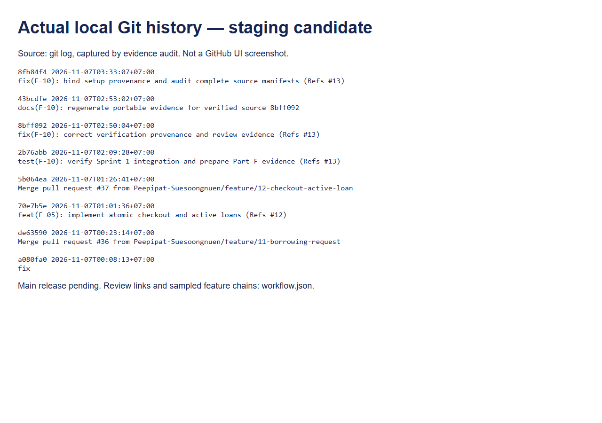

# Workflow, contributions and AI-use declaration

This record distinguishes observed repository activity from unverified human claims. The user explicitly identified **L0u1sss as themself** and **Peepipat-Suesoongnuen as their teammate** during Issue #13. Names/student IDs for the submission cover and both students' confirmation of the final disclosure remain pending; no hours or equal-work percentages are invented.

## Verified history samples

| Issue / feature | Recorded contract before implementation | Branch / submitted head | Independent review / concrete substance | Staging integration |
|---|---|---|---|---|
| [#11](https://github.com/Peepipat-Suesoongnuen/PEW-DIY/issues/11), F-04 | `d13617b` — 5 Nov2026 02:25+07:00, Part E contracts; implementation `6b4c35d` — 6 Nov22:58+07:00 | `feature/11-borrowing-request`, final `a080fa0`; author L0u1sss | [PR #36 final review](https://github.com/Peepipat-Suesoongnuen/PEW-DIY/pull/36#pullrequestreview-5804196743), Peepipat-Suesoongnuen: reconciled fresh85/6 versus residue91/0, checked safe ownership/transactions and provenance; A-12 ratification remains explicit | [PR #36](https://github.com/Peepipat-Suesoongnuen/PEW-DIY/pull/36) merged into `sprint/1-staging` at `de63590`, 7 Nov00:23+07:00; merge author Peepipat-Suesoongnuen |
| [#12](https://github.com/Peepipat-Suesoongnuen/PEW-DIY/issues/12), F-05 | `d13617b` — 5 Nov02:25+07:00; revised by F-03 and user decisions before checkout baseline; implementation `70e7b5e` — 7 Nov01:01+07:00 | `feature/12-checkout-active-loan`, head `70e7b5e`; author L0u1sss | [PR #37 review](https://github.com/Peepipat-Suesoongnuen/PEW-DIY/pull/37#pullrequestreview-5804916583), Peepipat-Suesoongnuen: fresh PG17.11 tests115/70/51, locks/role/ownership/constraints/date/error mapping; no P0–P2; noted stale-DB debris as P3 | [PR #37](https://github.com/Peepipat-Suesoongnuen/PEW-DIY/pull/37) merged into staging at `5b064ea`, 7 Nov01:26+07:00; merge author Peepipat-Suesoongnuen |
| [#8](https://github.com/Peepipat-Suesoongnuen/PEW-DIY/issues/8), F-01 foundation (additional reciprocal sample) | Original F-01 contract predates implementation; security correction GREEN `288a1e3` | `feature/8-d1-06.1-authentication-rbac`, head `288a1e3`; author Peepipat-Suesoongnuen | [PR #22 final review](https://github.com/Peepipat-Suesoongnuen/PEW-DIY/pull/22#pullrequestreview-5776247539), L0u1sss: real-session missing-Origin/Referer denial without revocation; build39 tests verified; approved backend foundation only, deferred UI/E2E explicitly | [PR #22](https://github.com/Peepipat-Suesoongnuen/PEW-DIY/pull/22) merged into staging at `58c0b13`; merge author L0u1sss |

Full SHA/ref/review metadata is retained in [workflow.json](workflow.json). The audit verifies sampled head→merge→candidate ancestry and contract→F-04/F-05 head ancestry using actual Git objects. Review text was read and summarized, not inferred merely from APPROVED status. PR #22's historical title mentions33 tests; the final review records39, and neither is the current F-10 count. Feature PR merge does not automatically close a still-open Issue or shared Product DoD.

The image renders [actual local Git output](run/workflow-history.txt); it is explicitly not a fabricated GitHub UI. Final GitHub board state and release PR screenshot remain pending. No staging→main release chain is claimed: the observed main ref is `7bf6c8d`, not the staged increment.

## Contribution table — observed artifacts

| Student/account | Observed contribution | Evidence and limits |
|---|---|---|
| L0u1sss (user) | Auth/RBAC peer review and merge; F-04 request implementation/docs remediation; F-05 checkout/loans implementation; user decisions on quantity and timezone; supervision/request of F-10 local verification work | PR #22 review; authored commits/PRs #36/#37; explicit work-session instructions. F-10 was committed/pushed as `2b76abb` and submitted by L0u1sss in PR #38; it remains under review and is not integrated |
| Peepipat-Suesoongnuen (teammate) | Auth/RBAC implementation/security corrections; substantive F-04/F-05 peer review, independent PG17 verification reports, reviewer integration of PR #36/#37 | PR #22 authorship and final review discussions on #36/#37; Git merge authorship. Reviewer test results are attributed reports, distinct from local PG18 runs |

This table records repository/session evidence, not a claim that either person manually wrote every generated line or performed every local command. Pair-work duration, off-repository activities and equal contribution percentages were not supplied. Both students must confirm they understand the design/tests/released behavior and approve the final attribution before submission.

## AI-use declaration

Codex assisted with reading supplied course documents and repository contracts, implementing/reviewing code and tests, executing local verification, preparing source fingerprints, demo images and evidence prose, and analyzing prior GitHub reviews. In the Issue #13 session it added verification tooling and tests, ran actual server/client/browser suites and timed fresh-project setup, and prepared the release handoff. Tests use real PostgreSQL and actual app processes; AI statements are not substituted for results or independent peer approval.

The human user supplied quantity/timezone decisions and identified the two accounts. GitHub authors/reviewers and merge SHAs above come from observed metadata. The user committed/pushed the original F-10 work and opened PR #38. Codex prepared local work and remediation; it did not post comments, change the board, approve its own work, merge a PR, create a tag or publish a release. Source/evidence provenance is recorded separately from those human GitHub actions. Humans remain responsible for reviewing generated work, ratifying policy, validating disclosures, merging reviewed PRs and submitting the assessed release/PDF.
